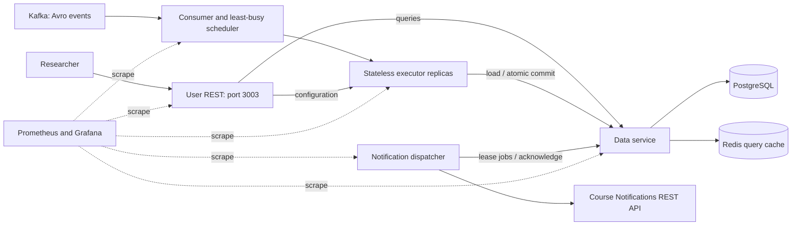

# XYZ Lab temperature observability — Group 15

This Python implementation consumes the supplied producer's Avro events, exposes
the required REST API on port **3003**, and delivers notifications through a
durable outbox. It only observes temperature. The existing Rust course services
and their Compose files remain available as the supplied reference tools.

## Run locally

Requires Docker Engine with Compose v2, and Python 3.12+ for host-side tests.
Run commands from the repository root. Prefix Docker commands with `sudo` if
your account does not have Docker socket access.

```sh
python3 -m venv .venv
.venv/bin/pip install -r requirements.lock
.venv/bin/pip install --no-deps -e .
docker compose -f compose.yml build data api
docker compose -f compose.yml -f compose.local.yml up -d
curl http://localhost:3003/health
.venv/bin/python -m loadtests.stress --experiments 3 --sensors 3 \
  --duration 3 --http-rps 20 --output test-results/smoke.json
```

The local overlay includes a single-node Kafka broker and a **local notification
validator**. Test emails use `example.invalid`; local tests do not call the
course's notification service. The validator checks every notification against
the generator's expected experiment, measurement, researcher, and type. Its
test-only ciphertext is opaque to the implementation.

| Service | Address |
| --- | --- |
| Public REST API and OpenAPI UI | `http://localhost:3003`, `/docs` |
| Scheduler status | `http://localhost:8001/status` (loopback only) |
| Data service, local overlay only | `http://localhost:8002` (loopback only) |
| Local test notification records | `http://localhost:18080/test/notifications` |
| Local Kafka, host-side producer | `localhost:19092` |

PostgreSQL uses a named volume. Redis holds disposable cached query responses.
`docker compose -f compose.yml -f compose.local.yml down` stops the stack while
retaining history and Kafka data. Deleting volumes destroys those local records.

## REST API

The two assignment endpoints return **JSON arrays** of `{timestamp, temperature}`
objects in timestamp order. Only carry-out measurements appear. Both time bounds
are inclusive, including a query where start and end are equal. The out-of-range
endpoint returns every out-of-range measurement, including later readings in an
already-notified excursion.

```sh
curl -G http://localhost:3003/temperature \
  --data-urlencode 'experiment-id=EXPERIMENT_ID' \
  --data-urlencode 'start-time=0' --data-urlencode 'end-time=2000000000'
curl -G http://localhost:3003/temperature/out-of-range \
  --data-urlencode 'experiment-id=EXPERIMENT_ID'
```

Additional endpoints support the rest of the brief:

- `POST /experiments`: configure using the exact configuration-event JSON shape.
  The Kafka `experiment_configured` event is the normal course input. Identical
  repeated configurations are accepted; changes to an existing configuration
  return 409. The researcher can query an experiment immediately after successful
  configuration, even when its history is still empty.
- `GET /experiments/{id}`: configuration, lifecycle status, latest aggregate,
  start/end timestamps, and number of incomplete measurement groups.
- `GET /temperature/out-of-range/intervals?experiment-id=...`: excursion start and
  end timestamps. An excursion ends at the first subsequent in-range reading,
  or at termination. An ongoing excursion has `end_time: null`.
- `GET /health`, `GET /metrics`: readiness and Prometheus metrics.

Unknown experiments return 404; malformed queries, non-finite timestamps, and
reversed time bounds return 422. Valid empty histories return `[]`. Gateway
connection failures and upstream response timeouts return 503, so callers can retry.

## Architecture and responsibilities



| Component | Responsibility |
| --- | --- |
| `scheduler.py`, `codec.py` | Poll Kafka, decode Avro object containers, batch ordered events, discover executor replicas and dispatch to the least busy available one. |
| `executor.py`, `engine.py` | Validate lifecycle events, aggregate sensor groups, detect range transitions, and produce state/history/outbox changes. No local durable experiment state. |
| `data.py`, `schema.sql` | Own PostgreSQL and Redis; atomically commit state, history, deduplication progress, rejected events, and notification jobs; serve history queries. |
| `deploy/Caddyfile`, `api.py` | The User REST container forwards public queries to Data and configurations to an executor. Each destination validates its own inputs. `api.py` defines the OpenAPI contract and a Python development entry point. |
| `notification.py` | Lease a bounded batch of jobs, send concurrently, and record delivery or schedule retries. |
| `autoscale.py` | Host-side control of executor replica count from scheduler load, with upper/lower bounds and cooldowns. |

### Aggregation and lifecycle

Each sample is grouped by **experiment and measurement ID**, not by the latest
reading of each sensor. Every configured sensor must contribute exactly once;
duplicate readings do not increase the sensor count. All readings in a group
must agree on timestamp and hash. Inclusive thresholds are applied to the
arithmetic mean of all sensors. The original hash is forwarded as `cipher_data`.

During stabilization, a complete in-range sample sends `Stabilized` if the
previous sample was absent or out of range. This includes re-entry, matching
`compute_notification_type` in the supplied producer. Starting the experiment
resets the previous-range state. During carry-out, the first out-of-range sample
of each excursion sends `OutOfRange`; a later in-range sample enables the next
alert. The service waits for the researcher's explicit start event and never
starts or controls an experiment itself.

Completed stabilization groups are retained internally for deduplication but
excluded from both history endpoints. Terminated experiments remain queryable.
Incomplete groups are persisted in the experiment state and drained in timestamp
order; later complete groups wait for earlier incomplete groups. The number of
incomplete groups per experiment defaults to 256 and is configurable. Exceeding
that limit, or changing phase while a group is incomplete, is quarantined for
operator inspection rather than silently calculating an average with missing
sensors. The course producer emits complete groups in order.

### Ordering, replay, and failures

The producer keys all events of an experiment to the same Kafka partition. The
scheduler executes one batch at a time **per partition**, while different
partitions can use different executors. This preserves lifecycle and sensor
ordering without tying an experiment permanently to a container. It also bounds
useful simultaneous task execution by the topic's partition count.

Kafka auto-commit is disabled. The executor loads a database snapshot and proposes
one transaction containing state versions, aggregate measurements, notification
jobs, rejected records, and the partition checkpoint. The Data service checks
versions and locks the checkpoint. A conflict rolls back the whole transaction,
and the executor reloads and recomputes. Kafka offsets are committed only after
that transaction succeeds. A lost response or a restarted consumer can safely
replay an already committed batch. Logical measurement duplicates at new Kafka
offsets are also deduplicated.

Snapshot requests contain only distinct experiment and measurement IDs. Sensor
payloads are decoded and processed by the executor; they are not sent a second
time to Data merely to identify the state to load.

This follows Kafka's documented requirement to coordinate offsets with durable
processing effects: [Confluent consumer documentation](https://docs.confluent.io/platform/current/clients/consumer.html).
Keep the consumer group stable on ordinary restarts. If you deliberately recreate
a topic with reset offsets while retaining PostgreSQL, use a new consumer group
namespace; its old database checkpoints describe a different stream.
The local and demo overlays use different default groups for this reason. If
overriding `TO_KAFKA_GROUP`, keep it distinct between Kafka clusters that share
this PostgreSQL database.

The scheduler pauses fetching when its queue reaches 8,192 events and continues
polling for group membership. One already-fetched batch can exceed that bound by
up to 512 events. Invalid input is recorded in `rejected_events`; infrastructure
errors are retried and never treated as invalid experiment input.

Outbox claims use PostgreSQL `FOR UPDATE SKIP LOCKED` and expiring leases.
Dispatchers can scale independently. A failed process's leased jobs become
available again. HTTP 429, authentication failures, timeouts, and server failures
are retried with bounded backoff; permanent payload/endpoint errors remain
visible as failed jobs. Delivery is **at least once**: if the remote service
accepts a notification just before the sender crashes, it may be sent again.
An `Idempotency-Key` is included, but the course API does not promise to honor it.
The database prevents ordinary replays from creating duplicate jobs; it cannot
make an external HTTP side effect exactly once.

Redis cache keys include the database experiment version and query arguments.
Queries use a consistent PostgreSQL snapshot, so writes cannot leave an older
cached answer under the current version. The single Data process keeps a bounded
cache of experiment versions; every state transaction invalidates those entries
before and after the write, including rollback or cancellation. Concurrent reads
cannot refill that cache with stale versions. Keep Data at one process/replica;
adding Data writers requires shared metadata invalidation first. Executors and
notification dispatchers can scale independently.

Redis outages fall back to PostgreSQL. Cache operations have a short timeout, no
automatic retries, and a two-second circuit breaker. Redis I/O never holds a
database connection. PostgreSQL emits history JSON directly from one consistent
query snapshot. Pool release retains automatic transaction rollback but skips
session-reset SQL because this service does not use session variables, SQL
cursors, listeners, or session-level advisory locks.

The public gateway uses Caddy to keep HTTP forwarding off the Python event loops.
Only the public routes are forwarded; internal task and outbox routes return 404
at port 3003. Caddy exposes its own Prometheus request metrics. The generated
OpenAPI document is served locally; the Swagger UI at `/docs` loads its UI assets
from jsDelivr.

## Scaling and sizing

See [STRESS-TEST-RESULTS.md](STRESS-TEST-RESULTS.md) for measured defaults and limits.
The key settings are `TO_EXECUTOR_REPLICAS`, `TO_EXECUTOR_CAPACITY`,
`TO_BATCH_SIZE`, `TO_NOTIFICATION_INTERVAL`, and `TO_NOTIFICATION_CONCURRENCY`.
An executor permits eight concurrent task batches by default; the scheduler uses
reported active tasks plus local reservations when selecting a replica.

```sh
docker compose -f compose.yml -f compose.local.yml up -d \
  --no-deps --scale executor=2 executor
.venv/bin/python -m temperature_observability.autoscale --minimum 1 --maximum 4
```

The autoscaler runs on the Docker host; it does not mount the Docker socket into
the application. It adds a replica after five seconds of sustained backlog or
high executor utilization, and removes one after sixty idle seconds. Use
`--dry-run` to inspect decisions. If Docker needs root, run this process with
`sudo .venv/bin/python ...`. For the course deployment, pass
`--compose-file compose.yml --compose-file compose.demo.yml` and optionally
`--env-file .env.monitoring`.

More executors help when execution is the bottleneck. PostgreSQL, the Data
service, the Kafka partition count, and the VM's CPU eventually limit throughput.
Redis caches are memory bounded; historical data and deduplication records grow
with experiment duration on disk. Scaling within a VM cannot create additional
physical CPU or remove a shared database bottleneck.

## Metrics and cost overview

```sh
docker compose -f compose.yml -f compose.local.yml -f compose.monitoring.yml \
  up -d prometheus node-exporter grafana
```

Prometheus runs on port **3008**. Grafana is bound to loopback on port **3004**,
with a provisioned **XYZ Lab — Temperature Observability** dashboard. Anonymous
users can view it locally; administrator login defaults to `admin` / `local-demo`
and can be changed with `TO_GRAFANA_PASSWORD`. On a remote VM, forward port 3004
over SSH to view Grafana from your browser.

Panels show event throughput, queue depth, executor load, notification p99 and
oldest pending age, HTTP throughput/p95, failed jobs, cache hit rate, process
memory, VM CPU, database size, and estimated infrastructure cost over time.
Prometheus discovers executor replicas through Docker DNS.

Copy `monitoring.env.example` to `.env.monitoring`, supply the VM's actual
`TO_VM_HOURLY_COST_USD` and `TO_STORAGE_GB_MONTHLY_COST_USD`, and pass
`--env-file .env.monitoring` to Compose. Costs default to **unconfigured (zero)**;
the dashboard exposes that explicitly. The cost series is the configured VM
hourly rate plus measured PostgreSQL storage at the supplied GB-month rate.
The 24-hour panel integrates available 15-second samples. This is an estimate,
not an AWS billing feed; allocated-but-unused disk, network fees, external course
infrastructure, and monitoring retention need separate billing inputs.

Alert rules cover pending alerts approaching 10 seconds, excess notification
latency, rejected notifications, invalid input, and unreachable services. Rules
are visible in Prometheus; external alert routing requires an Alertmanager.

## Course/demo configuration

The demo follows `DEMO-INSTRUCTIONS.md`: topic `experiment`, API port 3003,
and `https://notifications.cec.dlandau.nl/api/notify?token=...`.
For private producer testing, set `TO_KAFKA_TOPIC` to the group's authorized
topic. Do not publish test events to the read-only demo topic.

```sh
python3 scripts/prepare-monitoring-credentials.py group15-credentials
docker compose -f compose.yml -f compose.demo.yml build data api
docker compose -f compose.yml -f compose.demo.yml up -d
```

Use the local and demo overlays separately. The demo overlay mounts only the
Kafka CA, PKCS12 keystore, extracted password, and notification token into the
services that need them. It does not mount AWS, SSH, or Grafana credentials.
The extraction script creates a mode-0600 password file without printing it.
Set `TO_CREDENTIALS_DIR`, `TO_CREDENTIAL_UID`, and `TO_CREDENTIAL_GID` if the
directory or its owner differs from the default `group15-credentials`, UID/GID
1000. Credential directories and generated secrets are excluded from Git and
from the Docker build context. Notification URL tokens are not written to logs.

Kafka uses certificate and hostname verification by default. If the course
requires a different broker endpoint, set `TO_KAFKA_BROKERS`; the complete
security configuration is in `config.py`. `TO_KAFKA_ENDPOINT_IDENTIFICATION`
exists for explicitly configured course certificates; the default is `https`.
External availability must be verified when deploying. Local test results do
not establish latency across the course's network and notification service.

## Verification and operations

```sh
.venv/bin/python -m pytest -q -m 'not integration'
TO_TEST_STACK=1 .venv/bin/python -m pytest -q
.venv/bin/ruff check temperature_observability loadtests tests scripts/prepare-monitoring-credentials.py
.venv/bin/python -m loadtests.matrix --docker-command 'sudo -n docker'
.venv/bin/python -m loadtests.recovery --docker-command 'sudo -n docker'
```

Integration tests create and drop isolated test databases on the local PostgreSQL
server. The recovery script restarts the local executor, scheduler, Data, and
PostgreSQL containers and temporarily stops Redis; run it outside a load measurement.
The matrix compares replica counts and notification polling intervals, validates
every final history and alert, and restores the smallest passing executor count
at the fastest tested interval. Raw results are written under `test-results/`.

The load generator defaults to 100 concurrent experiments, 10 sensors each,
1-second sampling, and 200 HTTP requests/second. These sensor and HTTP settings
are explicit test scenarios, not claims about an unspecified absolute maximum:
the README permits arbitrary sensor counts and does not reveal demo workloads.
Increase `--sensors`, decrease `--period`, or raise `--http-rps` to test beyond
the minimum requirement. HTTP requests are paced independently of response time;
reported latency includes client queuing and achieved throughput includes drain
time. Requests time out after ten seconds rather than hiding a growing backlog.

Useful diagnostics:

```sh
docker compose -f compose.yml -f compose.local.yml logs --tail 100 scheduler executor notification
curl http://localhost:8001/status
docker compose -f compose.yml exec postgres psql -U observability -d observability
```

Inspect `rejected_events` for invalid source records, and
`notification_outbox` for `status='failed'`, HTTP status, attempts, and lease state.
Keep both the PostgreSQL volume and Kafka retention available during recovery.
Back up PostgreSQL with `pg_dump` before changing deployments or retention.
