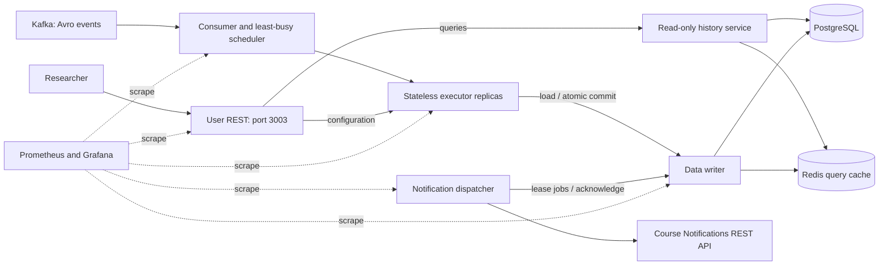

# XYZ Lab temperature observability — Group 15

This Python implementation consumes the supplied producer's Avro events, exposes
the required REST API on port **3003**, and delivers notifications through a
durable outbox. It only observes temperature. The existing Rust course services
and their Compose files remain available as the supplied reference tools.

## Run locally

Requires Docker Engine with Compose v2, and Python 3.12+ for host-side tests.
Run commands from the repository root. Prefix Docker commands with `sudo` if
your account does not have Docker socket access.

```sh
python3 -m venv .venv
.venv/bin/pip install -r requirements.lock
.venv/bin/pip install --no-deps -e .
docker compose -f compose.yml build data api
docker compose -f compose.yml -f compose.local.yml up -d
curl http://localhost:3003/health
.venv/bin/python -m loadtests.stress --experiments 3 --sensors 3 \
  --duration 3 --http-rps 20 --output test-results/smoke.json
```

The local overlay includes a single-node Kafka broker and a **local notification
validator**. Test emails use `example.invalid`; local tests do not call the
course's notification service. The validator checks every notification against
the generator's expected experiment, measurement, researcher, and type. Its
test-only ciphertext is opaque to the implementation.

| Service | Address |
| --- | --- |
| Public REST API and OpenAPI UI | `http://localhost:3003`, `/docs` |
| Scheduler status | `http://localhost:8001/status` (loopback only) |
| Data service, local overlay only | `http://localhost:8002` (loopback only) |
| History reader, local overlay only | `http://localhost:8003` (loopback only) |
| Local test notification records | `http://localhost:18080/test/notifications` |
| Local Kafka, host-side producer | `localhost:19092` |

PostgreSQL uses a named volume. Redis holds disposable cached query responses.
`docker compose -f compose.yml -f compose.local.yml down` stops the stack while
retaining history and Kafka data. Deleting volumes destroys those local records.

## Run the instructor's tests and grading panel

The assignment **does provide independent testing tools**. `experiment-producer`,
`notifications-service`, `http-load-generator`, and `observability/group_view.json`
are the instructor's supplied workload, validators, and grading dashboard.
The HTTP workload patterns used during the demo are withheld, but these tools
can be run at any time. The dashboard on port **3004** above is our operational
dashboard; the instructor's grading dashboard runs on **3009** below.

From the repository root, with the Python environment installed as above:

```sh
make course-test
```

This command builds the **unmodified Rust course sources**, starts the test
infrastructure, runs one short warmup experiment followed by three concurrent
experiments with three sensors and one-second sampling, and observes at least
60 seconds of instructor HTTP validation at 100 requests/second. The first build
downloads a Rust compiler container and can take around 30 minutes on a small VM;
later builds are cached. Docker, Compose, OpenSSL, Make, and the Python environment are needed on the host;
Rust is built inside Docker. The runner uses `sudo -n docker` automatically if
the current user cannot access Docker directly.

The published notification Docker image predates the repository's JWT/public-key
configuration, so the test image is built from the repository instead. No course
validator logic is replaced. The tools use generated local TLS certificates,
a local AES key, and a local signing key for a `group15` test JWT. Actual group
credentials and the external notification service are not used in this local run.

The setup automatically provisions **both Prometheus and PostgreSQL data sources**
and selects **group15** in the original Group View dashboard. It uses a separate
database for instructor ground truth and notification latencies. Our own Python
implementation remains the system under test; the instructor's `run_to` reference
implementation is not started.

Open `http://localhost:3009/d/cec-course-grading` in your browser. On a remote VM,
run this command **on your laptop** using your existing SSH key and VM address:

```sh
ssh -N -L 3009:127.0.0.1:3009 -i /path/to/your/key ubuntu@YOUR_VM_PUBLIC_IP
```

Then open the same localhost URL on your laptop. Grafana permits anonymous viewing
over this local tunnel. Its local administrator defaults to `admin` / `course-local`.

```sh
make course-check   # Explicit pass/fail, including checks that real data exists
make course-stress  # 100 concurrent experiments, 10 sensors, 1s sampling, 100 HTTP/s
make course-stop    # Stop generated load; keep the panel and stored results
```

The HTTP validator continues querying completed experiments after the initial
test result, for up to 255 minutes, so the live panel remains useful. Stop it
with `make course-stop` when finished. `make course-panel` starts the panel and
services without generating a new workload; an empty panel is not a pass.

The runner writes `test-results/course-latest.json` and a timestamped result.
After a check, the dashboard's default time range is pinned to that test, so
opening it later still shows the result. Each report also contains a URL with
the exact time range. A new run restores the live window. A successful check
requires a completed producer, nonzero expected notifications, no missing or late
notifications, no validator errors, successful checks of **both** REST endpoints,
and at least 95% of the requested HTTP rate over the observed window. It also
checks both complete history endpoints for every experiment against the supplied
producer's ground-truth documents. An additional status panel shows this explicit
result; the original instructor panels retain their queries. Green or zero-valued panels with
no workload do not satisfy these checks. Passing a chosen workload does not
establish performance for every possible hidden demo workload.

For custom loads:

```sh
.venv/bin/python -m loadtests.course run --experiments 100 --sensors 10 \
  --samples 60 --http-rps 100 --http-seconds 60
```

The warmup terminates before the requested concurrent experiments start; it
provides a ground-truth experiment for HTTP queries while the main experiment
load runs. The course overlay uses separate event/document topics and a separate
application consumer group. It switches the local application's scheduler and
notification destination to this test setup while retaining application history.
Use `make course-stop` before switching to the demo configuration below.

## REST API

The two assignment endpoints return **JSON arrays** of `{timestamp, temperature}`
objects in timestamp order. Only carry-out measurements appear. Both time bounds
are inclusive, including a query where start and end are equal. The out-of-range
endpoint returns every out-of-range measurement, including later readings in an
already-notified excursion.

```sh
curl -G http://localhost:3003/temperature \
  --data-urlencode 'experiment-id=EXPERIMENT_ID' \
  --data-urlencode 'start-time=0' --data-urlencode 'end-time=2000000000'
curl -G http://localhost:3003/temperature/out-of-range \
  --data-urlencode 'experiment-id=EXPERIMENT_ID'
```

Additional endpoints support the rest of the brief:

- `POST /experiments`: configure using the exact configuration-event JSON shape.
  The Kafka `experiment_configured` event is the normal course input. Identical
  repeated configurations are accepted; changes to an existing configuration
  return 409. The researcher can query an experiment immediately after successful
  configuration, even when its history is still empty.
- `GET /experiments/{id}`: configuration, lifecycle status, latest aggregate,
  start/end timestamps, and number of incomplete measurement groups.
- `GET /temperature/out-of-range/intervals?experiment-id=...`: excursion start and
  end timestamps. An excursion ends at the first subsequent in-range reading,
  or at termination. An ongoing excursion has `end_time: null`.
- `GET /health`, `GET /metrics`: readiness and Prometheus metrics.

Unknown experiments return 404; malformed queries, non-finite timestamps, and
reversed time bounds return 422. Valid empty histories return `[]`. Gateway
connection failures and upstream response timeouts return 503, so callers can retry.

## Architecture and responsibilities



| Component | Responsibility |
| --- | --- |
| `scheduler.py`, `codec.py` | Poll Kafka, decode Avro object containers, batch ordered events, discover executor replicas and dispatch to the least busy available one. |
| `executor.py`, `engine.py` | Validate lifecycle events, aggregate sensor groups, detect range transitions, and produce state/history/outbox changes. No local durable experiment state. |
| `data.py`, `schema.sql` | One `data` writer atomically commits experiment state, measurements, checkpoints and notification jobs. A separate `data-read` process serves public histories using the same database; it has no internal mutation endpoints and uses read-only PostgreSQL transactions. |
| `deploy/Caddyfile`, `api.py` | The deployed User REST container forwards public queries to `data-read` and configurations to an executor. Each destination validates its inputs. `api.py` defines the OpenAPI contract and a Python development entry point. Caddy's reload endpoint is bound only to its container loopback address. |
| `notification.py` | Lease a bounded batch of jobs, send concurrently, and record delivery or schedule retries. |
| `autoscale.py` | Host-side control of executor replica count from scheduler load, with upper/lower bounds and cooldowns. |

### Aggregation and lifecycle

Each sample is grouped by **experiment and measurement ID**, not by the latest
reading of each sensor. Every configured sensor must contribute exactly once;
duplicate readings do not increase the sensor count. All readings in a group
must agree on timestamp and hash. Inclusive thresholds are applied to the
arithmetic mean of all sensors. The original hash is forwarded as `cipher_data`.

During stabilization, a complete in-range sample sends `Stabilized` if the
previous sample was absent or out of range. This includes re-entry, matching
`compute_notification_type` in the supplied producer. Starting the experiment
resets the previous-range state. During carry-out, the first out-of-range sample
of each excursion sends `OutOfRange`; a later in-range sample enables the next
alert. The service waits for the researcher's explicit start event and never
starts or controls an experiment itself.

Completed stabilization groups are retained internally for deduplication but
excluded from both history endpoints. Terminated experiments remain queryable.
Incomplete groups are persisted in the experiment state and drained in timestamp
order; later complete groups wait for earlier incomplete groups. The number of
incomplete groups per experiment defaults to 256 and is configurable. Exceeding
that limit, or changing phase while a group is incomplete, is quarantined for
operator inspection rather than silently calculating an average with missing
sensors. The course producer emits complete groups in order.

### Ordering, replay, and failures

The producer keys all events of an experiment to the same Kafka partition. The
scheduler executes one batch at a time **per partition**, while different
partitions can use different executors. This preserves lifecycle and sensor
ordering without tying an experiment permanently to a container. It also bounds
useful simultaneous task execution by the topic's partition count.

Kafka auto-commit is disabled. The executor loads a database snapshot and proposes
one transaction containing state versions, aggregate measurements, notification
jobs, rejected records, and the partition checkpoint. The Data service checks
versions and locks the checkpoint. A conflict rolls back the whole transaction,
and the executor reloads and recomputes. Kafka offsets are committed only after
that transaction succeeds. A lost response or a restarted consumer can safely
replay an already committed batch. Logical measurement duplicates at new Kafka
offsets are also deduplicated.

Snapshot requests contain only distinct experiment and measurement IDs. Sensor
payloads are decoded and processed by the executor; they are not sent a second
time to Data merely to identify the state to load.

This follows Kafka's documented requirement to coordinate offsets with durable
processing effects: [Confluent consumer documentation](https://docs.confluent.io/platform/current/clients/consumer.html).
Keep the consumer group stable on ordinary restarts. If you deliberately recreate
a topic with reset offsets while retaining PostgreSQL, use a new consumer group
namespace; its old database checkpoints describe a different stream.
The local and demo overlays use different default groups for this reason. If
overriding `TO_KAFKA_GROUP`, keep it distinct between Kafka clusters that share
this PostgreSQL database.

The scheduler pauses fetching when its queue reaches 8,192 events and continues
polling for group membership. One already-fetched batch can exceed that bound by
up to 512 events. Invalid input is recorded in `rejected_events`; infrastructure
errors are retried and never treated as invalid experiment input.

Outbox claims use PostgreSQL `FOR UPDATE SKIP LOCKED` and expiring leases.
Dispatchers can scale independently. A failed process's leased jobs become
available again. HTTP 429, authentication failures, timeouts, and server failures
are retried with bounded backoff; permanent payload/endpoint errors remain
visible as failed jobs. Delivery is **at least once**: if the remote service
accepts a notification just before the sender crashes, it may be sent again.
An `Idempotency-Key` is included, but the course API does not promise to honor it.
The database prevents ordinary replays from creating duplicate jobs; it cannot
make an external HTTP side effect exactly once.

Redis cache keys include the database experiment version and query arguments.
Queries use a consistent PostgreSQL snapshot, so writes cannot leave an older
cached answer under the current version. The single Data writer keeps a bounded
cache of experiment versions; every state transaction invalidates those entries
before and after the write, including rollback or cancellation. Concurrent reads
cannot refill that cache with stale versions. Keep Data at one process/replica;
adding Data writers requires shared metadata invalidation first. The separate
read-only process re-reads an active experiment's version from PostgreSQL on each
request. It only retains metadata for terminated experiments, whose histories
cannot change. Executors, read-only processes and dispatchers can scale independently.

Redis outages fall back to PostgreSQL. Cache operations have a short timeout, no
automatic retries, and a two-second circuit breaker. Redis I/O never holds a
database connection. PostgreSQL emits history JSON directly from one consistent
query snapshot. Pool release retains automatic transaction rollback but skips
session-reset SQL because this service does not use session variables, SQL
cursors, listeners, or session-level advisory locks.

The public gateway uses Caddy to keep HTTP forwarding off the Python event loops.
Only the public routes are forwarded; internal task and outbox routes return 404
at port 3003. Caddy exposes its own Prometheus request metrics. The generated
OpenAPI document is served locally; the Swagger UI at `/docs` loads its UI assets
from jsDelivr.

## Scaling and sizing

See [STRESS-TEST-RESULTS.md](STRESS-TEST-RESULTS.md) for measured defaults and limits.
The key settings are `TO_EXECUTOR_REPLICAS`, `TO_EXECUTOR_CAPACITY`,
`TO_BATCH_SIZE`, `TO_NOTIFICATION_INTERVAL`, and `TO_NOTIFICATION_CONCURRENCY`.
An executor permits eight concurrent task batches by default; the scheduler uses
reported active tasks plus local reservations when selecting a replica.

```sh
docker compose -f compose.yml -f compose.local.yml up -d \
  --no-deps --scale executor=2 executor
.venv/bin/python -m temperature_observability.autoscale --minimum 1 --maximum 4
```

The autoscaler runs on the Docker host; it does not mount the Docker socket into
the application. It adds a replica after five seconds of sustained backlog or
high executor utilization, and removes one after sixty idle seconds. Use
`--dry-run` to inspect decisions. If Docker needs root, run this process with
`sudo .venv/bin/python ...`. For the course deployment, pass
`--compose-file compose.yml --compose-file compose.demo.yml` and optionally
`--env-file .env.monitoring`.

More executors help when execution is the bottleneck. PostgreSQL, the Data
service, the Kafka partition count, and the VM's CPU eventually limit throughput.
Redis caches are memory bounded; historical data and deduplication records grow
with experiment duration on disk. Scaling within a VM cannot create additional
physical CPU or remove a shared database bottleneck.

Backpressure counts queued and in-flight records. Each partition has high/low
watermarks based on its share of the configured queue, while the global guard
still bounds total work. A hot partition therefore pauses independently instead
of occupying the entire queue and starving other partitions. `/status` exposes
partition queues and paused partitions. One fetched batch can overshoot the
global threshold by up to 512 records. This does not reorder records within a
partition or acknowledge them before their database commit.

## Metrics and cost overview

```sh
docker compose -f compose.yml -f compose.local.yml -f compose.monitoring.yml \
  up -d prometheus node-exporter grafana
```

Prometheus runs on port **3008**. Grafana is bound to loopback on port **3004**,
with a provisioned **XYZ Lab — Temperature Observability** dashboard. Anonymous
users can view it locally; administrator login defaults to `admin` / `local-demo`
and can be changed with `TO_GRAFANA_PASSWORD`. On a remote VM, forward port 3004
over SSH to view Grafana from your browser.

Panels show event throughput, queue depth, executor load, notification p99 and
oldest pending age, HTTP throughput/p95, failed jobs, cache hit rate, process
memory, VM CPU, database size, and estimated infrastructure cost over time.
The additional panels separate database connection waits from time spent holding
a connection, show free disk space, and count every accepted notification at or
above the strict 10-second deadline. Connection occupancy includes transaction
work and event-loop scheduling; it is not a pure PostgreSQL execution timer.
Prometheus discovers executor replicas through Docker DNS.

Copy `monitoring.env.example` to `.env.monitoring`, supply the VM's actual
`TO_VM_HOURLY_COST_USD`, `TO_STORAGE_GB_MONTHLY_COST_USD`, and
`TO_STORAGE_PROVISIONED_GB`, and pass `--env-file .env.monitoring` to Compose.
Costs default to **unconfigured (no data)**; `to_cost_configured=0` makes the
missing inputs explicit. Cost is VM hourly rate plus **provisioned** disk size
times the monthly storage rate divided by 730. Stored database size is a
separate capacity metric. Adding containers on the same VM does not multiply
the VM's hourly price.
The 24-hour panel integrates available 15-second samples. This is an estimate,
not an AWS billing feed; CPU surplus credits, public IPv4, network fees, taxes,
discounts and external course infrastructure are excluded. The November price
lookup is saved in `benchmarks/2026-11-05/aws-public-pricing.json`; it does not
establish the account's actual bill or the attached EBS volume type.

Alert rules cover pending alerts approaching 10 seconds, any observed deadline
miss, database pool waits, disk space/growth, rejected notifications, invalid
input, and unreachable services. Historical sent/rejected totals refresh once
per minute; pending/failed counts and oldest pending age refresh every five seconds. Rules
are visible in Prometheus; external alert routing requires an Alertmanager.

### Variable workload validation and bounded history caching

Use `make course-variable` for the repository's original Rust validators at
100 concurrent experiments, 10 sensors, 1 Hz and random HTTP targets from 100
through 200 requests/second. Each generation lasts 20 seconds. The report
requires at least two distinct settled targets and checks throughput and the
validator's effective rate in every observed phase. Its gauges describe
processed batches, so this is complemented by `make stress-variable` on the
plain **local** stack: an independent open-loop ramp of 50 → 200 → 100 rps.
Do not run the two workloads simultaneously or point synthetic local data at
the external notification service. Stop the Rust generators with `make course-stop`.

The runner reuses completed instructor binaries only when their saved image ID
and a fingerprint of the public Rust/build inputs both match. This avoids
recompiling Rust merely because disposable builder layers were cleaned up to
free disk space. Application images still rebuild normally. `--rebuild-tools`
forces a tool rebuild; allow several GiB of working space for Rust compilation.
`--skip-build` explicitly bypasses all builds and requires existing images.

The open-loop report includes intended versus scheduled requests, generator
delay, errors, latency including semaphore waits, and each phase's drain time.
Dropped load, a slow phase, or any failed HTTP request makes the run fail.
`*.telemetry.json` records VM CPU (including steal separately), scheduler queues,
Data connection timings and cache counters. All runners enforce notification
latency **strictly less than 10 seconds**; exactly 10 seconds fails.

Data keeps at most 16,384 history points across 256 snapshot entries, with at
most 512 points per experiment. Queries over a small snapshot use binary search
for inclusive time bounds. Concurrent cold reads share a fill. Snapshot data and
its version come from one database statement; commits fence metadata updates,
and reads never reuse an older snapshot for a newer version. Long histories use
the existing indexed SQL/Redis path: a bounded 513-row probe detects them, and
a bounded marker avoids repeating the probe. No stored history is truncated or
deleted. Set `TO_HISTORY_CACHE_POINTS=0` to disable this optimization for comparison.

Snapshots encode measurement JSON once per version, then answer time windows by
slicing complete JSON values at precomputed offsets. This removes repeated JSON
encoding on cache hits. Point and entry limits bound these encoded snapshots too.
One Data writer owns mutations; read-only processes use the revalidation rule
above rather than depending on another process's in-memory invalidation.

The course notification receiver returns its own latency in the response body.
The notifier uses a finite, nonnegative receiver value for its deadline metric;
otherwise it falls back to the local-clock estimate. The local estimate and the
chosen clock source are exported separately. This matters because the course
receiver clock was about 25 seconds behind the VM on 6 November. Existing stored
latencies are preserved. See the [live incident record](benchmarks/2026-11-06/README.md).

Local Kafka test retention is limited by both age and bytes per partition
(32 MiB, with 16 MiB segments). This does not change the instructor's Kafka
cluster. Local Prometheus retention is bounded by size as well as time. Kafka
deletes whole closed segments, and Prometheus also has active/WAL overhead:
these settings are not a hard cap on total disk use. PostgreSQL history remains
persistent and needs enough capacity for experiment duration. Remove obsolete
build artifacts when necessary; never use `docker compose down -v` to free space.

## Course/demo configuration

The demo follows `DEMO-INSTRUCTIONS.md`: topic `experiment`, API port 3003,
and `https://notifications.cec.dlandau.nl/api/notify?token=...`.
For private producer testing, set `TO_KAFKA_TOPIC` to the group's authorized
topic. Do not publish test events to the read-only demo topic.

```sh
python3 scripts/prepare-monitoring-credentials.py group15-credentials
docker compose -f compose.yml -f compose.demo.yml build data api
docker compose -f compose.yml -f compose.demo.yml up -d
```

Use the local and demo overlays separately. The demo overlay mounts only the
Kafka CA, PKCS12 keystore, extracted password, and notification token into the
services that need them. It does not mount AWS, SSH, or Grafana credentials.
The extraction script creates a mode-0600 password file without printing it.
Set `TO_CREDENTIALS_DIR`, `TO_CREDENTIAL_UID`, and `TO_CREDENTIAL_GID` if the
directory or its owner differs from the default `group15-credentials`, UID/GID
1000. Credential directories and generated secrets are excluded from Git and
from the Docker build context. Notification URL tokens are not written to logs.

The base configuration verifies both CA trust and hostnames. The **demo overlay**
defaults `TO_KAFKA_ENDPOINT_IDENTIFICATION` to `none`, matching the course tutorial:
the broker certificates identify `kafka-1`/`kafka-2`/`kafka-3`, while clients connect
to `kafka.cec.dlandau.nl`. CA chain validation and client authentication remain
enabled. Set `TO_KAFKA_ENDPOINT_IDENTIFICATION=https` when the course supplies
certificates matching its public hostname.

Run the read-only connection check before the professor's demo:

```sh
make course-kafka-check
.venv/bin/python scripts/check-course-kafka.py --topic group15
```

It checks broker metadata and actual consumer partition assignment without
publishing events or committing offsets. The verified connection results are
recorded in `benchmarks/2026-10-08/`. Strict hostname verification failed with
OpenSSL's `hostname mismatch`; the course-compatible configuration connected
successfully to both authorized topics. Local test results still do not measure
latency across the course's notification network during a professor-run workload.

## Verification and operations

```sh
.venv/bin/python -m pytest -q -m 'not integration'
TO_TEST_STACK=1 .venv/bin/python -m pytest -q
.venv/bin/ruff check temperature_observability loadtests tests scripts/prepare-monitoring-credentials.py
.venv/bin/python -m loadtests.matrix --docker-command 'sudo -n docker'
.venv/bin/python -m loadtests.recovery --docker-command 'sudo -n docker'
```

Integration tests create and drop isolated test databases on the local PostgreSQL
server. The recovery script restarts the local executor, scheduler, Data, and
PostgreSQL containers and temporarily stops Redis; run it outside a load measurement.
The matrix compares replica counts and notification polling intervals, validates
every final history and alert, and restores the smallest passing executor count
at the fastest tested interval. Raw results are written under `test-results/`.

The load generator defaults to 100 concurrent experiments, 10 sensors each,
1-second sampling, and 200 HTTP requests/second. These sensor and HTTP settings
are explicit test scenarios, not claims about an unspecified absolute maximum:
the README permits arbitrary sensor counts and does not reveal demo workloads.
Increase `--sensors`, decrease `--period`, or raise `--http-rps` to test beyond
the minimum requirement. HTTP requests are paced independently of response time;
reported latency includes client queuing and achieved throughput includes drain
time. Requests time out after ten seconds rather than hiding a growing backlog.

Useful diagnostics:

```sh
docker compose -f compose.yml -f compose.local.yml logs --tail 100 scheduler executor notification
curl http://localhost:8001/status
docker compose -f compose.yml exec postgres psql -U observability -d observability
```

Inspect `rejected_events` for invalid source records, and
`notification_outbox` for `status='failed'`, HTTP status, attempts, and lease state.
Keep both the PostgreSQL volume and Kafka retention available during recovery.
Back up PostgreSQL with `pg_dump` before changing deployments or retention.
