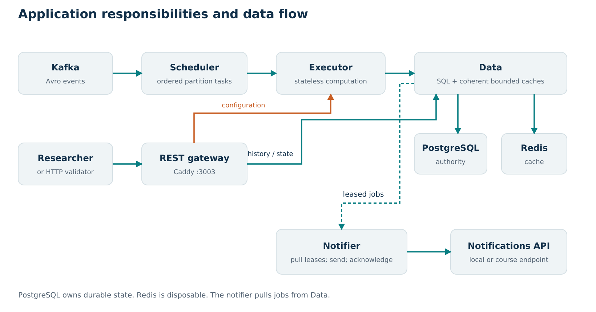
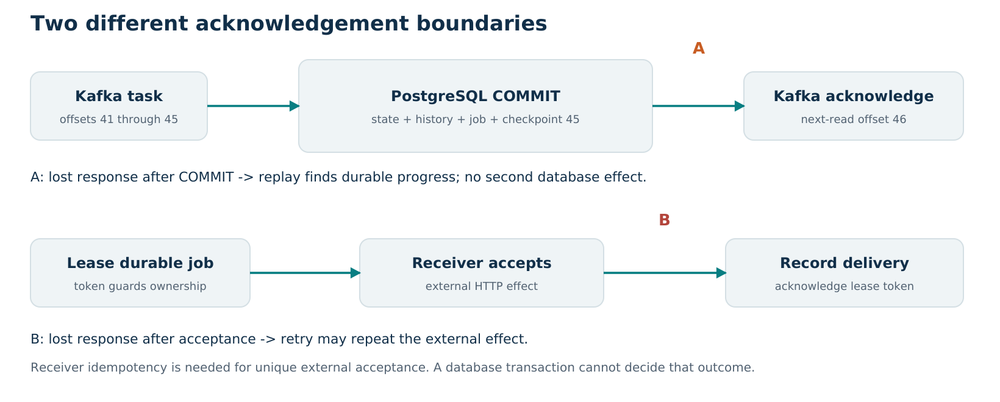

# Architecture and correctness defense

The central design decision is to commit experiment state, measurements, notification obligations, and processing progress together before acknowledging Kafka. Service boundaries then separate responsibilities that have different ordering, latency, and scaling requirements. Every optimization must preserve that consistency boundary.

## Responsibilities and deployment

| Component | Owns | Scaling or failure boundary |
| --- | --- | --- |
| Kafka consumer and scheduler | Avro intake, partition queues, batch order, reservations, offset acknowledgement | One active task per partition; hot keys and broker retention |
| Stateless executor | State-machine computation and commit proposals | Capacity eight per replica; shared Data and CPU remain downstream |
| Data | Durable writes, history reads, cache coherence, notification leases | One process owns writes and local invalidation; PostgreSQL capacity |
| Caddy public API | Public routing and transport | Downstream availability; extra gateway overhead; public routes only |
| Notification dispatcher | HTTP delivery, retry, lease acknowledgement | Receiver latency, concurrency, lease recovery |
| PostgreSQL | Authoritative state, history, checkpoints, jobs, rejected input | Disk/CPU/locks/connections; single deployment |
| Redis | Disposable serialized history responses | Bounded memory and hit rate; fallback increases database work |

Prometheus, node exporter, and Grafana observe the system. They do not participate in the experiment transaction. The local instructor producer, HTTP validator, notification validator, and their truth database are test infrastructure, distinct from the application under test. All are cohosted in local capacity tests.

The public port is 3003. Caddy forwards history/state reads to Data and configuration requests to an executor. The Python `api.py` remains the development API/OpenAPI definition, while the deployed public request path uses Caddy. Internal load/commit/claim endpoints are not exposed by that gateway.

## One measurement through the complete system

Suppose experiment E has sensors A, B, and C. They report measurement M at time t, with a shared opaque measurement hash. A reading from A does not establish the mean. The executor stores it in a partial group and commits that state. A different executor can later load the group, add B and C, and complete the calculation.

The engine validates allocation, matching identity/timestamp/hash, duplicate consistency, phase, and temporal order. Once complete, it uses `math.fsum(values) / count`, classifies the inclusive range, updates prior range state, and creates a measurement plus any transition notification. Later complete groups wait behind earlier incomplete groups within an experiment.

The executor loads a database snapshot, processes a bounded batch, and posts a commit proposal. Data checks the expected checkpoint and experiment versions. Within one transaction it writes state, measurements, jobs, rejected events, and progress. A successful response lets the scheduler commit Kafka's next offset. The notifier subsequently leases an outbox job and sends the required payload; the original opaque hash is forwarded as `cipher_data`, not decrypted by our implementation.

## State machine and interface semantics

| State or transition | Behavior |
| --- | --- |
| Configured | Configuration persisted; state queryable; required histories may be empty |
| Stabilizing | Complete sensor groups monitored; Stabilized on entry/re-entry into the allowed range |
| Started | Researcher event enters running; prior excursion state resets |
| Running | Every complete average retained; OutOfRange only when starting an outside excursion |
| Terminated | Retains history and termination time; new measurements rejected |

The engine also permits direct start from configured and cancellation before carry-out. A transition with incomplete groups is rejected rather than fabricating missing temperatures. Duplicate identical configuration and lifecycle events are handled idempotently; conflicting configuration is rejected.

Temperature thresholds are inclusive: a mean equal to either boundary is in range. History start/end bounds are inclusive, with stable ordering for equal timestamps. The required outside endpoint includes every outside carry-out point. The interval convenience endpoint closes an excursion at the next in-range point or termination time; an ongoing excursion has an open end.

Stabilization measurements are stored internally but filtered out of required carry-out histories. This supports completed-ID deduplication without changing the external query contract. [Engine](../../temperature_observability/engine.py), [schema](../../temperature_observability/schema.sql), [history rendering](../../temperature_observability/history.py).

## Ordering, replay, and concurrent writes

The scheduler constructs a stream identity from consumer group and topic and permits one task at a time per assigned partition. It processes Avro object-container records and treats the `record_name` Kafka header as authoritative. This accommodates the supplied producer's termination-schema mismatch without modifying instructor code.

Partition order depends on the producer consistently routing one experiment to one partition. Adding partitions or changing key routing during an experiment is therefore not a harmless capacity switch. Versions can detect competing writes, but they do not invent a missing total order between different input partitions.

Kafka offset commits and PostgreSQL transactions are separate operations. The application checkpoint links database effects to input progress. If Data commits offset 45 but Kafka still points to 41, replay loads the durable checkpoint and suppresses already committed effects; Kafka can then commit next-read offset 46. A duplicate completed measurement at a new Kafka offset is separately detected by its logical identity.

Batch state writes sort experiment IDs, pipeline adjacent inserts/updates, and check every returned version. A stale version fails the transaction, so the executor reloads and recomputes; it does not publish a partially updated batch. The integration test with a stale middle version is stronger than merely testing that a loop invokes a database method.

## The read path and its correctness

Three layers have different purposes. The metadata cache avoids repeated version lookups. The bounded snapshot cache reuses a whole small carry-out history across different query windows. Redis stores serialized responses for exact version/query combinations; indexed SQL serves misses and larger histories.

A bounded probe reads metadata/version and at most 513 points in one SQL statement. Histories of at most 512 points can become a snapshot. Large histories receive an eviction-bounded marker and fall through to the original query path; they are not truncated to 512 points. The cache allows at most 16,384 points and 256 entries, including empty histories and large markers. `TO_HISTORY_CACHE_POINTS=0` disables it for comparison.

Binary search locates inclusive time boundaries. A cached snapshot must have a version at least as new as the request's metadata requirement. An older fill cannot replace a newer cached snapshot. Concurrent cold readers share a per-experiment fill lock; locks are released and removed when no waiter remains.

Metadata is invalidated around writes. Commit-time warming uses values returned/known by the successful transaction, but only when its generation remains the final uncontended writer. The important race is: writer A commits, releases its database connection slowly, writer B commits, then A resumes. Without a generation fence, A could replace newer metadata. The regression test forces this interleaving.

The guarantee is that an acknowledged write is not followed by indefinitely obsolete cache state. Concurrent reads may observe an earlier committed snapshot according to when they started. We do not claim a distributed linearizable cache across multiple Data processes. The current invalidation protocol assumes one Data process owns all writes. [Data](../../temperature_observability/data.py), [integration tests](../../tests/test_data_integration.py).

## Durable delivery and failure windows

| Failure | Result and recovery |
| --- | --- |
| Before the database commit | Proposed effects roll back; input can be recomputed |
| After commit, before Kafka acknowledgement | Durable checkpoint/history/outbox exist; replay is deduplicated |
| Worker disappears with a partial sensor group | Persisted partial state is reloaded by a replacement |
| Redis unavailable | Bounded cache failure/bypass; authoritative SQL fallback |
| Notifier stops after claiming | Lease expiry permits another claim |
| Receiver accepts but acknowledgement is lost | Retry can repeat external acceptance; receiver idempotency is required |
| Permanent input error | Durable quarantine permits partition progress; invalid experiment input is not repaired |
| Whole VM/disk unavailable | All colocated services may stop; container boundaries do not provide redundancy |

The notifier polls after an empty/failed claim every 0.1 seconds, sends up to 32 jobs concurrently, uses a two-second request timeout, and normally drains a nonempty backlog immediately. The lease is fifteen seconds. Results acknowledge a lease token so a stale worker cannot overwrite a newer lease holder's result. Retries use bounded delays; selected permanent HTTP failures are marked failed for inspection.

Reducing the poll interval alone cannot remove sensor-group waiting, Kafka queueing, SQL delays, receiver latency, or lease recovery. At a healthy empty-poll interval of 0.1 seconds, polling is only one part of the latency budget. A crash recovery lease can independently exceed the ten-second target.

## Backpressure and scaling

The global scheduler guard pauses at 8,192 queued plus in-flight events and resumes below 4,096. A fetched batch can overshoot a threshold; these are control watermarks, not a byte-exact memory bound. The Kafka client has its own buffering, and a task batch defaults to 256 events.

The final revision adds per-partition control. With 16 assigned partitions, the default share is max(256, 8192/16) = 512 events. A partition pauses at that share and resumes below half, subject to the global guard. Counting in-flight work prevents dispatch from appearing to free capacity before the batch completes. Assignment/revocation clears pause bookkeeping. Pausing leaves waiting input in Kafka; it does not guarantee deadlines during overload.

Executor discovery samples worker load and uses local reservations. Effective load is the greater of reported active work and reserved work. Least-busy dispatch is appropriate for broadly similar batches, but sensor counts, batch composition, and query/write costs can differ. Worker capacity enforcement remains the final guard.

The host-side autoscaler defaults to one through four replicas. It considers queue above 1,024 or occupancy at least 75% busy, scales up after five seconds, and scales down after sixty seconds fully idle. It is opt-in, not running continuously in the demo. The policy observes executor demand, not all downstream bottlenecks; extra executors on a CPU-bound host can make HTTP service worse.

For E experiments, S sensors, period T, input rate is E×S/T and aggregate rate E/T. For P partitions, K replicas and capacity C, active partition tasks are bounded by min(P, K×C). Service time, skew, database contention, and CPU determine actual throughput. These formulas should not be presented as measured capacity.

## Alternatives and tradeoffs

| Choice | Why it fits this implementation | Cost or alternative |
| --- | --- | --- |
| Explicit services | Isolate ordering, computation, queries, and external delivery | A modular monolith could reduce hops/operations on one VM |
| Python with asynchronous I/O | Pure domain code, rapid validation, concurrent network/database work; measured workload passes | CPU-heavy work remains constrained; language alone does not guarantee performance |
| PostgreSQL authority | Atomic cross-table effects, indexes, constraints, locking and versions | Shared database/process can bottleneck; replication needs a consistency design |
| Redis plus bounded snapshots | Reuse exact responses and different windows over small histories | Coherence complexity; small-history gains do not extrapolate to arbitrary duration |
| One measured executor | Smallest passing configuration in the earlier replica study | Requires reevaluation on a different workload or host |
| Durable outbox | Survives process loss and separates receiver delays | External duplicate window; lease/retry delay |
| Backpressure | Bounds application intake and improves fairness | Waiting moves upstream; lag/age must be observed |

## How to identify different bottlenecks

| Observation | First hypothesis | Discriminating check and response |
| --- | --- | --- |
| High CPU, growing queue and HTTP latency | Shared host saturation | Separate generator/service CPU; reduce proven overhead or add allowed resources |
| Long pool wait but high connection occupancy | Data/database contention | Compare operations and SQL/lock work; increasing the pool can worsen pressure |
| HTTP slows on cold/long histories while ingestion is healthy | Read/serialization workload | Compare cache hit/miss, history size, SQL access and response bytes |
| Free workers but uneven partition queues/lag | Key skew or sequential work | Inspect partition progress; fairness helps other partitions but cannot parallelize the hot one |
| Current history but aging outbox and retries | External receiver/network | Inspect outcomes and receiver delay; executor replicas are the wrong first action |
| Disk shrinking despite low CPU | Persistent history or disposable storage growth | Attribute volume/log/cache growth; preserve data and plan capacity |

Pool occupancy includes transaction execution, application work, and scheduling while a connection is held; it is not isolated SQL duration. Scheduler queue is not total broker lag. A p99 latency panel does not identify a missing alert. These distinctions keep the diagnosis tied to what each metric actually measures.

The [performance report](03-performance-and-development.md) separates observed bottlenecks from hypotheses. [The code map](09-code-map.md) links each mechanism to its implementation and tests.
