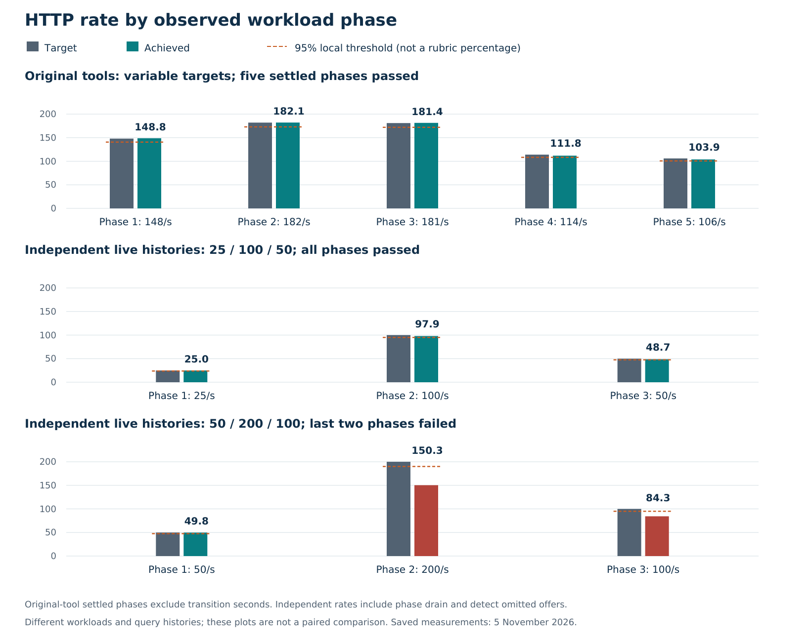
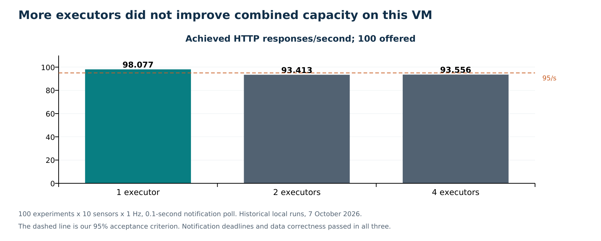

# Performance measurements and development history

The project improved through failures that could be linked to specific work: sequential state writes, repeated history/metadata reads, expensive monitoring counts, and test-controller overhead. The final results support the original tools' selected workloads while retaining an independently measured capacity limit. They do not establish unlimited throughput or a hosted professor-test pass.

## Environment and measurement meaning

The [host record](../../benchmarks/2026-11-05/host.json) identifies a t3a.medium in eu-west-1, two vCPUs, about 3.754 GiB memory, and 20 GiB provisioned disk. Application, local Kafka, databases, monitoring, and generators share the host in local tests. CPU saturation therefore describes the whole test setup, not solely application code. VM burst-credit behavior and longer-duration performance were not separately characterized.

The native harness executes the assignment's original Rust producer, notification validator, and HTTP validator. Their logic was not edited. It stores original ground truth and adds explicit nonzero-workload, complete-history, strict-latency, and throughput checks. The independent Python harness constructs expected histories/alerts and uses a local notification sink; it tests a different workload path.

Native HTTP batches are closed-loop: the effective gauge describes the last completed batch, while the target gauge describes current work. Variable validation groups observed targets, excludes the first two seconds after transitions, requires at least five seconds of settled evidence per counted phase, and requires at least two distinct targets. It compares both completed counter rate and settled effective rate with 95% of target. These exclusions mean transition behavior needs separate examination; the independent test includes scheduling and drain effects.

Independent phases start from intended send time. Latency includes generator delay and semaphore waiting. Completion after a phase extends that phase's rate denominator. Pending tasks are capped at 1,000; an omitted offer fails the test. A later easy phase cannot average away a failed busy phase.

Event-to-acceptance latency also depends on comparable producer and receiver clocks. The local runs share the host clock; the external path needs clock synchronization to interpret timestamps correctly. Our notifier clamps negative elapsed values to zero, so its metric alone cannot diagnose clock skew. A wall-clock adjustment is a different issue from queueing delay.

## Latest capacity results

| Workload | Required and received alerts; maximum | HTTP result |
| --- | --- | --- |
| Native variable 100–200 configured, 80 main samples | 703/703; 2.883569 s | Five observed phases passed; zero validation errors |
| Native fixed 200/s, 60 main samples | 596/596; 8.957969 s | 190.573087 achieved/s; local pass with little headroom |
| Independent 25:15,100:30,50:15 | 1,626/1,626; 6.189247 s | Achieved 25.000, 97.926, 48.744/s; all phases pass |
| Independent 50:15,200:30,100:15 | 1,626/1,626; 8.526757 s | Achieved 49.821, 150.329, 84.335/s; final two phases fail |

Both native runs used 100 concurrent main experiments, ten sensors, a one-second sample period, one completed warmup, and at least ninety seconds of HTTP observation. Each checked both complete history endpoints for 101 experiments: **202 comparisons**, not 202 experiments. Random temperatures explain different expected alert counts.

The native variable sequence was **148, 182, 181, 114, 106** requests/second. Settled achieved rates were 148.770, 182.099, 181.406, 111.826, and 103.876. The configured upper bound 200 was not itself observed in that random sequence. The fixed run addresses that target separately.

The fixed native result exceeds the local 190/s threshold by only 0.573/s, with a 1.042-second observed notification margin below ten seconds. These margins are results of one short run. The rubric says keep up with HTTP; it does not define our 95% rule or promise that the professor uses it.

The failed independent busy phase intended 6,000 requests but scheduled only 5,526. All scheduled requests succeeded, yet 474 offers were omitted and completion took 36.759 seconds from phase start, producing 150.329/s. Zero HTTP errors is therefore compatible with a failed throughput requirement. Its busy-phase HTTP p95 was 7.189 seconds; this statistic must not be assigned to the native fixed run.

Sources: [native variable](../../benchmarks/2026-11-05/course-variable-final.json), [native fixed](../../benchmarks/2026-11-05/course-200-final.json), [independent pass](../../benchmarks/2026-11-05/variable-100-final.json), [independent failure](../../benchmarks/2026-11-05/variable-final.json).

## What changed during development

| Observation | Change and protected invariant | Measured result or practical lesson |
| --- | --- | --- |
| Separately arriving readings | Persist partial groups; group by measurement identity and allocated sensors | Replacement workers preserve completeness; no mixed-time averages |
| Termination schema/header mismatch upstream | Honor record_name header; add codec regression | Compatibility without changing instructor tools |
| External Kafka connection failures | Diagnose public-name certificate mismatch; apply demo-specific hostname exception while retaining CA/client authentication | Fresh preflight obtained 16 assignments; ports alone had not proved Kafka readiness |
| Published test image/configuration mismatch | Build original Rust sources with local test credentials | Independent original-tool validation became reproducible |
| October native stress: three late alerts and 86.848 achieved/s | Pipeline sorted version-checked state writes; test stale-middle rollback | Next run: 5.641-s maximum and 97.310 achieved/s, with correct histories |
| More executors reduced combined HTTP throughput | Select one measured passing replica, keep bounded scaling available | Shared resources matter more than container count |
| November recovered DB had millions of measurements | Reduce historical metric scan frequency; add status index | Avoid repeated scans over a 125 MB outbox heap |
| Repeated metadata/history round trips | Warm committed metadata with generation fence; bounded small-history snapshots | Independent 200 peak improved, but remained a failure |
| Native variable phases still lagged | Replace repeated Compose resolution with cached IDs and one inspect call | Later native variable run passed; controller cost is part of the shared setup |
| Raw transport/uvloop trial underperformed | Revert the trial; keep its failed evidence | Fewer abstractions did not establish a better end-to-end result |
| Retained backlog exposed hot partitions | Add per-partition watermarks with global guard, preserve ordering | Final tests and real backlog exercise; no isolated healthy-load speedup claim |
| Disk exhaustion removed runtime availability | Recover named volumes; retain compiled tool image; source/image cache reuse; log/retention limits and disk alerts | Approximately five GiB reclaimed headroom before report dependencies; authoritative volumes retained |

These are recorded development observations. They do not establish that every feature was authored on its first mention or that every team member personally implemented it.

## Before and after evidence

October's [initial native run](../../benchmarks/2026-10-09/course-stress-initial.json) delivered 632/632 alerts, maximum 10.715822 seconds, and achieved 86.847621 HTTP/s against 100 offered. The [following run](../../benchmarks/2026-10-09/course-stress.json) delivered 610/610, maximum 5.640533 seconds, and achieved 97.309762/s. Both had 202 correct history comparisons. The observed changes are 47.36% lower maximum delay and 12.05% higher achieved rate, not isolated or replicated causal estimates.

November's independent 200-peak sequence retained the same configured profile and expected notification count:

| Revision/run | Busy-phase achieved/s | HTTP errors | Interpretation |
| --- | ---: | ---: | --- |
| Baseline | 97.300 | 449 | Overload with timeouts |
| Metadata warming | 106.536 | 148 | Fewer errors and metadata reads, still overloaded |
| Snapshots and lighter monitoring | 150.329 | 0 | More work completes, but offers omitted and phase throughput fails |
| Raw transport/uvloop trial, reverted | 131.367 | 0 | Failed offers/throughput; not in final implementation |

Metadata reads in the instrumented baseline/warming pair changed from 4,546 to 2,732. Mean sampled host CPU utilization in the snapshot boundary run was approximately 99.38%. The controller experiment measured about 0.953 CPU seconds for three Compose ps calls versus 0.145 for three direct inspections. These observations support targeted reductions of work. They do not provide a complete exclusive CPU profile by component.

The native variable progression retained two failures: [before snapshots](../../benchmarks/2026-11-05/course-variable-before-snapshots.json) had three alerts at/above ten seconds and a 10.372-second maximum; [with snapshots](../../benchmarks/2026-11-05/course-variable-snapshots.json) met alert deadlines but failed some HTTP phases. The later passing run followed the controller improvement. Random temperature paths, rate sequences, cache state, and shared-host conditions differ, so no single-edit speedup percentage is attributed to this sequence.

## Executor sizing and polling

The [October 7 matrix](../../benchmarks/2026-10-07/sizing-matrix.json) used 100 experiments, ten sensors, one-second samples, 30 carry-out samples, and 100 offered HTTP/s. At a 0.1-second notification poll, one executor achieved 98.077 HTTP/s, two achieved 93.413, and four achieved 93.556. Correctness and notification deadlines passed in those rows; the latter two missed the local HTTP threshold.

One executor was the smallest passing configuration. Among passing tested polling choices, 0.1 seconds had the lowest observed HTTP p95 in that short matrix. It is a measured default, not a proof of an optimal constant. Those runs predate later optimizations, so the matrix explains the decision but is not a current replicated scaling curve.

## Tests and operational recovery

The [final suite](../../benchmarks/2026-11-05/tests-final.txt) passed **92 tests in 13.12 seconds**, including 14 integration cases. Unit tests cover engine/codec behavior, strict latency boundaries, cache bounds, scheduler fairness, transport, cost calculation, load accounting, and tool-build invalidation. Integration cases exercise real PostgreSQL transaction/version/cache behavior and the public gateway.

The [recovery exercise](../../benchmarks/2026-11-05/recovery.json) preserved four history points and three notifications through partial readings, replay at new offsets, executor and scheduler restart, two injected notification 503s, Redis loss, and Data/PostgreSQL restart. Clearing Data's RAM cache while Redis was unavailable ensures the final read genuinely exercised persistent recovery.

The live recovery initially found 2,860,538 retained offsets behind the sampled broker positions. Existing progress was preserved; offsets were not reset to latest. Later sampling found zero lag to the sampled broker positions and no pending/failed jobs or quarantined events. The database held 3,028,234 measurements at that final readiness observation. This is evidence of catch-up, not timely delivery of old alerts or recovery of broker-expired input. [Readiness](../../benchmarks/2026-11-05/readiness-final.json).

Capacity runs preceded the final scheduler fairness change. The final tests and real backlog exercise validate that later revision in different ways. A new fixed/variable performance run on its exact source/image identity remains an appropriate future check.

## Reproducibility and stronger future experiments

Retain source/image identity, host capacity, background services, cold/warm state, workload parameters, actual event generation, phase-level completions, required/received alerts, maximum latency, queue/lag and disk growth. Preserve failures and reverted experiments. The native test uses random traces; comparing settings is not the same as comparing identical input.

In a scheduled local-test window, repeat key runs at least three times, then change one factor at a time: event concurrency, sensor count, history length, cache state, key skew, or external receiver delay. Hold plateaus long enough to observe backlog growth and recovery. Separate fault-recovery tests from healthy-load latency tests. A longer soak is needed to characterize storage growth, burst credits, and indefinite-duration experiments.

A useful latency budget is sensor completion + broker waiting + scheduler queue + execution/Data commit + outbox waiting + receiver acceptance. Instrument the longest stage before adding workers. Backpressure can preserve memory while that budget still exceeds ten seconds.
