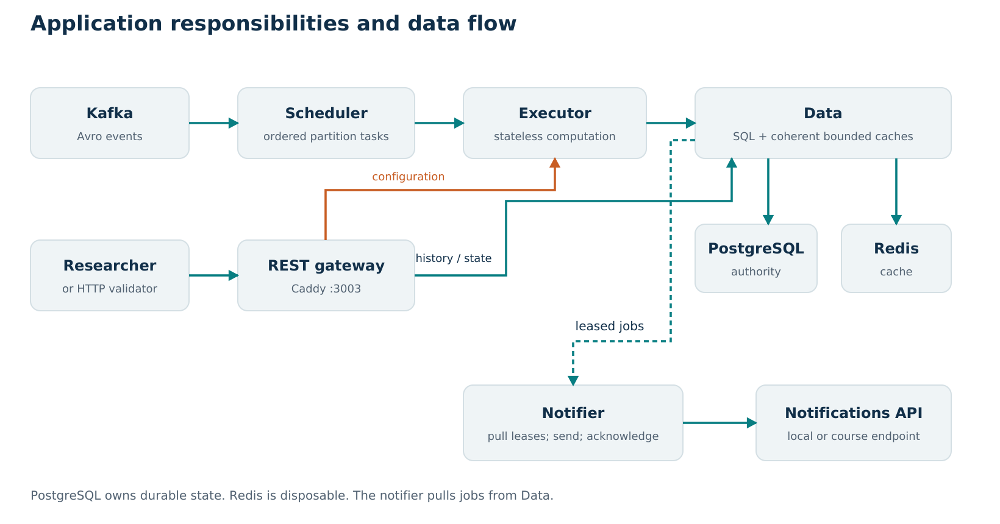

# Temperature observability implementation and evaluation

Group 15 built a containerized temperature monitoring service for concurrent laboratory experiments. It consumes Kafka events, computes complete-sensor averages, preserves experimental history, exposes the required REST queries, and delivers transition notifications. The design separates ordered ingestion, stateless computation, authoritative persistence, public queries, and external notification delivery.

The latest suite passed 92 tests. Local execution of the original instructor tools passed changing HTTP targets within 100–200 requests/second and a separate fixed 200 target. An independent live-history workload passed at a 100-request/second peak but failed at 200, identifying a remaining capacity boundary on the shared two-vCPU deployment. These outcomes guide both our design defense and future work.

## Requirements and domain interpretation

The system observes temperature; another system controls it. An experiment's temperature is the arithmetic mean of all allocated sensors for the same measurement identity. Combining the latest readings across different sampling instants could invent a temperature that was never measured, so incomplete groups wait and are persisted across executor replacement.

Configuration makes an experiment queryable. Stabilization triggers a Stabilized notification when the complete average enters the inclusive configured range. The experiment starts only on the researcher's start event. During carry-out, the first outside measurement of each excursion triggers OutOfRange; subsequent outside measurements remain in historical queries without generating another alert. Termination retains prior history. Stabilization aggregates can be persisted internally for processing and deduplication, but required history responses filter to carry-out.

The required outside endpoint returns all outside measurement points. A separate convenience endpoint derives excursion intervals. Thus three consecutive outside samples produce three outside-history points but one transition notification. Treating these counts as interchangeable would violate the interface contract.

## Architecture and rationale

Kafka intake is implemented by a scheduler that decodes Avro records, maintains ordered partition queues, and dispatches bounded batches to the least-busy available executor. Local reservations prevent multiple assignments from relying on the same stale load observation. One active task per partition preserves order, assuming the producer keeps each experiment on one partition.

Executors load durable state, apply the pure state machine, and propose a commit. They do not own persistent experiments. Data owns the PostgreSQL transaction, query/cache behavior, and notification leases. Caddy exposes the public API, forwarding reads directly to Data and configuration to an executor. A separate notifier drains the durable outbox with bounded concurrency.

A modular monolith would reduce service hops and operational overhead on this small VM. Explicit services were chosen to match responsibilities with different ordering and scaling needs: computations can move between workers, history reads benefit from caches, and external delivery delays should not block intake. The measured replica results also show the cost: extra containers on the same CPUs do not create additional capacity.

PostgreSQL is authoritative because a single transaction can link state, history, outbox obligations, and processing progress. Redis is a disposable response cache. An additional bounded in-process snapshot cache accelerates small histories; larger histories retain the indexed SQL/Redis path. This keeps persistent correctness independent of either cache while limiting RAM growth.

## Consistency and recovery

Data commits experiment versions, completed measurements, notification jobs, rejected input, and a partition checkpoint atomically. Kafka's next-read offset is acknowledged only after durable success. A crash before commit leaves work to recompute. A crash after commit but before acknowledgement can replay events, which the database checkpoint and measurement identities deduplicate.

Expected-version checks prevent silent lost updates. Batched writes retain deterministic lock order and verify every returned version; a conflict rolls back the complete transaction. An integration regression deliberately makes the middle of three proposed versions stale and verifies that none of them partially commits.

Cache correctness is also explicit. Histories and their version are read from one SQL statement. Metadata invalidation and active-writer generations prevent a delayed old writer from warming obsolete metadata after a newer commit. A snapshot can serve a request only when it is sufficiently current. Cold readers share a fill, and cache eviction changes performance rather than deleting history.

Notifications use a transactional outbox and leases. This preserves the obligation through process loss, but it does not make an external HTTP side effect exactly once. A receiver may accept a notification before the sender loses the response. Retrying then needs receiver-side idempotency for unique acceptance. A fifteen-second lease can also exceed the ten-second deadline during failure recovery; durability and latency through outages are distinct properties.

## Implementation evolution

Development began with contract and state-machine correctness: complete groups, phases, inclusive boundaries, duplicates, and replay. Integration exposed a producer compatibility detail: termination messages use a started-event Avro schema, while the Kafka `record_name` header correctly identifies termination. The decoder honors that header, with a regression test.

An early full instructor workload returned correct histories but had three late notifications and insufficient completed HTTP throughput. State writes were changed from sequential per-experiment database round trips to sorted, pipelined operations with all version checks preserved. Under the same configured October workload, maximum notification latency changed from 10.716 to 5.641 seconds and achieved HTTP throughput from 86.848 to 97.310/s. Random temperature paths differed, so these observations do not isolate a statistical causal effect.

After disk exhaustion and container/image cleanup, the retained PostgreSQL volume reopened with 2,326,784 measurements. The recovered, larger database revealed avoidable monitoring and read work. November changes added bounded versioned history snapshots, commit-time metadata warming with race fencing, indexed notification-status counts, and less frequent scans of historical monitoring totals. Pool wait and connection occupancy are now measured separately.

The local test controller itself was also expensive. Repeated Compose graph inspection consumed substantially more CPU than direct container inspection. The runner now caches container IDs and inspects both generators together. A separate raw-transport/uvloop experiment did not improve the independent boundary workload and was reverted rather than claimed as an optimization.

Restoring the demo consumer revealed 2,860,538 offsets of retained backlog in the initial broker snapshot. The scheduler gained per-partition high/low watermarks so one hot partition could not monopolize intake buffering. The existing consumer group caught up to the sampled broker positions without resetting offsets. Historical alerts from the outage remained late, and data no longer retained by Kafka cannot be reconstructed by this recovery.

## Evaluation

The local host is an AWS t3a.medium in eu-west-1, with two vCPUs, approximately 3.754 GiB RAM, and 20 GiB provisioned disk. Application, databases, local Kafka, generators, and monitoring shared those resources. Both native tests used 100 main experiments, ten sensors per experiment, one-second samples, and a completed warmup before the main load.

| Test | Notification result | HTTP and consistency result |
| --- | --- | --- |
| Original tools, variable targets 100–200 | 703/703; maximum 2.884 s | Five observed target phases passed; 202 complete history comparisons |
| Original tools, fixed target 200/s | 596/596; maximum 8.958 s | 190.573 achieved/s; 202 complete history comparisons; narrow local pass |
| Independent live histories, 25/100/50 profile | 1,626/1,626; maximum 6.189 s | All phases passed; peak achieved 97.926/s; no mismatches |
| Independent live histories, 50/200/100 profile | 1,626/1,626; maximum 8.527 s | Failed: busy phase achieved 150.329/s and omitted some offered requests, despite zero request errors |

The native variable targets actually observed were 148, 182, 181, 114, and 106. Our 95% throughput threshold is a local operational rule, not a percentage specified by the rubric. Notification acceptance is strict: missing, invalid, nonfinite, negative, or at-least-ten-second values fail.

The independent scheduler accounts for intended send time, scheduling delay, semaphore waiting, omitted offers, and phase drain time. Therefore a low error count cannot conceal overload. Native and independent runs have different query timing, histories, pacing, and notification receivers; their results are complementary rather than interchangeable.

The final suite contains 78 unit and 14 integration cases. Recovery testing preserved four history points and three alerts through partial-group persistence, replay, component restarts, notification 503s, Redis loss, and PostgreSQL restart with the Data process cache cleared. These are specific tested failure cases, not a claim of host-level high availability.

Capacity measurements preceded the final scheduler fairness revision. That revision passed the complete final suite and was exercised on the retained live backlog. A repeat capacity run on the exact final revision remains useful follow-up evidence.

Sources: [native variable](../../benchmarks/2026-11-05/course-variable-final.json), [native fixed](../../benchmarks/2026-11-05/course-200-final.json), [independent pass](../../benchmarks/2026-11-05/variable-100-final.json), [independent failure](../../benchmarks/2026-11-05/variable-final.json), [tests](../../benchmarks/2026-11-05/tests-final.txt), [recovery](../../benchmarks/2026-11-05/recovery.json).

## Scalability, cost, and operational limits

Sensor input rate is E×S/T for E experiments, S sensors, and sample period T. Aggregate rate is approximately E/T. At 100 experiments, ten sensors, and one second, these are 1,000 sensor events/s and 100 aggregates/s. With 16 assigned partitions and executor capacity eight, simultaneous partition tasks are bounded by min(16, 8K) for K executors. This bounds concurrency, not throughput.

Historical replica experiments favored one executor on the shared host. The bounded autoscaler remains available, but is not continuously active in the demo. Data currently assumes one process owns all writes; adding Data workers requires shared invalidation or removal of process-local metadata caching. More workers cannot fix a saturated database, a hot sequential partition, or a slow external receiver.

Cost is estimated as one VM's hourly price plus provisioned disk times its monthly unit price divided by 730. The recorded estimate is approximately $0.043211/hour using a 20 GiB gp3 assumption. Disk type is unconfirmed; CPU surplus credits, public IPv4, traffic, taxes, discounts, and course infrastructure are excluded. The [saved price evidence](../../benchmarks/2026-11-05/aws-public-pricing.json) supports an estimate, not an account bill.

Local Kafka/Prometheus retention and log limits reduce disposable growth; alerts identify low disk and deadline misses. Experiment history still grows with duration, and the application has no completed archival or off-host backup/restore program. External infrastructure-alert delivery is not configured. Separating services does not remove the single VM/disk failure domain.

## Conclusion and next steps

The implementation combines explicit correctness boundaries with measured revisions. The strongest evidence is the original tools' passing workloads, independent validation that retains failures, and a code-level explanation of how each optimization preserves consistency. The remaining priority is sustained demo health and representative repeated tests, including longer histories, event-rate changes, skew, and external-path validation. Additional resources or a shared invalidation design should follow measured bottlenecks and the allowed deployment constraints.

The [architecture report](02-architecture-and-correctness.md), [performance record](03-performance-and-development.md), and [complete code map](09-code-map.md) provide the detailed evidence. Individual contribution statements must be supplied by the group from actual work; preparation roles are not authorship claims.
