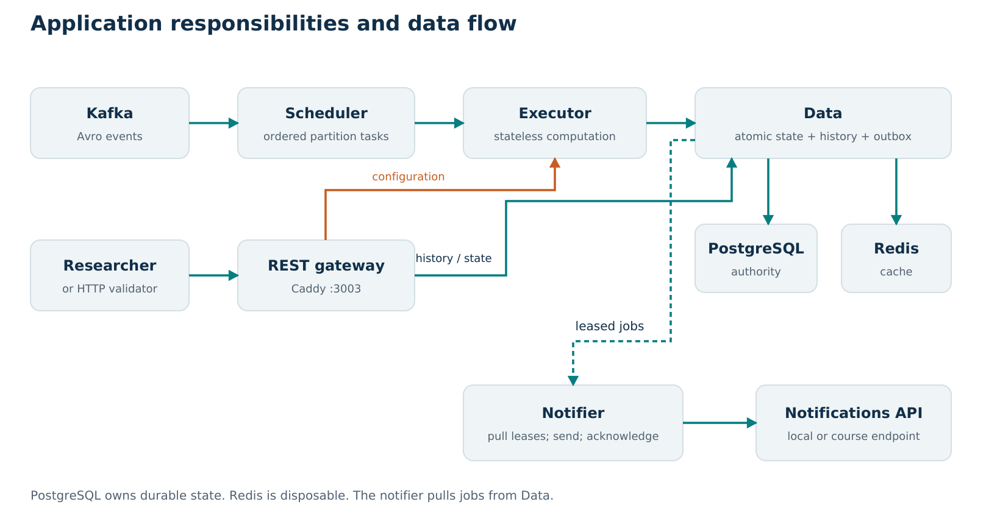

# Architecture and design defense

The application separates event intake, computation, durable storage, public reads, and notification delivery because they have different ordering, failure, and scaling requirements. Its central correctness decision is to commit experiment state, history, notification obligations, and Kafka progress together in PostgreSQL before acknowledging Kafka.

This architecture passed a specific local workload, but its scaling is constrained by a shared two-vCPU host, a single Data process, PostgreSQL, and Kafka partition ordering. Understanding those boundaries is part of the design defense.

## Requirements that shaped the design

The laboratory controls temperature elsewhere. This service only observes it. A measurement is the mean of all allocated sensors for one experiment and measurement ID. It cannot substitute the most recent readings from different sampling instants.

Configuration makes the experiment queryable immediately. Stabilization can produce a Stabilized notification. Carry-out begins only on the researcher's start event and contributes the history exposed by the required endpoints. During carry-out, only the first outside measurement of a continuous excursion triggers OutOfRange. Termination stops accepting new measurements but retains past history.

The two required read endpoints return ordered arrays of timestamp/temperature pairs. Time bounds are inclusive. The outside-history endpoint returns all outside measurements, although only the start of each excursion produces a notification. Those are separate products, so they must not share the same filtering rule. [Assignment requirements](../../README.md).

## Components and ownership

| Component | Owns | Does not own | Scaling boundary |
| --- | --- | --- | --- |
| Scheduler and decoder | Kafka membership, per-partition queues, ordered batches, executor selection | Durable experiment state | Sequential work within a partition; consumer membership and host resources |
| Stateless executor | Validation and state-machine computation for a task | Long-lived authoritative experiment data | Capacity eight by default; more replicas share downstream Data |
| Data | PostgreSQL transactions, history queries, Redis responses, outbox leases | Sending external notifications | One process owns local metadata-cache invalidation; database is shared |
| User REST gateway | Public routes, transport forwarding, docs, gateway metrics | Domain calculations or database ownership | Forwarding capacity and downstream response time |
| Notification dispatcher | Claiming jobs, HTTP delivery/retry, outcome acknowledgement | Deciding which measurement needs notification | Delivery concurrency, external endpoint, durable outbox |
| PostgreSQL | Authoritative states, aggregates, progress, jobs, rejected input | Disposable rendered query cache | CPU, I/O, locks, connection capacity, storage |
| Redis | Disposable versioned history responses | Authoritative history or experiment state | Memory bound and cache hit ratio |

The application workers are Python. Kafka, PostgreSQL, Redis, and Caddy are existing infrastructure components. Python's suitability is supported by measured end-to-end results and asynchronous I/O, not by a claim that Python is universally the fastest runtime.

## A measurement from Kafka to notification

For experiment E, configuration lists sensors A, B, and C. Messages for a measurement M share an ID, timestamp, and opaque hash. The decoder reads the Avro object container and its record_name Kafka header. The scheduler preserves their partition order and sends a bounded task batch to a reserved executor.

The executor loads a consistent snapshot containing E's state/version, the partition checkpoint, and relevant completed measurement identities. It adds A, B, and C to M's pending group. Only when all configured sensors have arrived does the pure engine compute the mean, classify the range, and create a history point and, when appropriate, an outbox job.

Data checks the proposed state versions and checkpoint inside one transaction. A successful commit records all effects together. The scheduler can then acknowledge the offset after the last processed event. The notifier later leases the job, sends the required payload with the original hash as cipher_data, and acknowledges its result.

The source producer uses an Avro started-event schema inside termination messages. The record_name header correctly identifies termination, so the decoder treats the header as authoritative. This is compatibility with the supplied implementation, not a modification of its source. [Decoder](../../temperature_observability/codec.py), [engine](../../temperature_observability/engine.py).

## Design decisions and alternatives

### Separation into services

A modular monolith would reduce network calls, serialization, operational overhead, and the number of failure points on a small VM. It is a credible alternative.

We chose explicit service boundaries to match the brief and to isolate responsibilities with different load patterns: Kafka consumption must preserve order, computation can be replicated, history reads benefit from caching, and slow notification delivery should not block ingestion. Internal HTTP makes these boundaries inspectable and independently deployable.

The cost is additional hops and shared-host contention. The replica experiments demonstrate this cost: extra executors did not improve combined HTTP capacity in the measured configuration. We therefore selected one executor instead of claiming that more containers automatically meant more scalability.

### Kafka for intake and replay

Kafka is the required interface and offers partition ordering, retained input, and independent consumer progress. We use these properties to recover from process loss. Kafka alone does not make PostgreSQL writes or an external HTTP call exactly once.

The scheduler uses one active task per partition. This preserves order without permanently binding an experiment to one executor. The producer must keep each experiment on a consistent partition. Scaling the consumer group can divide partitions, but cannot parallelize a single partition without another ordering mechanism.

Adding partitions to a live key-based topic is also a design change: reassignment of a key can break the assumed ordering across old/new partitions. It should not be presented as a risk-free scaling switch.

### Stateless executors

An executor's local counters and HTTP connections are temporary. Authoritative partial sensor groups, prior range state, lifecycle status, and versions live in PostgreSQL.

This makes worker replacement and load-based dispatch practical. The extra database round trips are the tradeoff. The later state-write optimization reduces that overhead without moving correctness-critical state back into workers.

### PostgreSQL as the authority

A relational database provides atomic multi-table transactions, uniqueness constraints, indexed history, row locks, and optimistic version checks. One transaction can link a measurement to its notification obligation and durable progress.

Redis-only state would need another durability and transaction strategy. A document store or stream-state framework could be considered, but would still need to satisfy replay, query, and external-delivery semantics. PostgreSQL fit the measured workload and kept these guarantees in a place the team could test directly.

The five tables are experiments, checkpoints, measurements, notification_outbox, and rejected_events. JSONB stores evolving experiment state; relational columns and indexes support common history queries and uniqueness. This is a hybrid representation, not storing every query field in an unindexed document. [Schema](../../temperature_observability/schema.sql).

### Redis as a disposable cache

Repeated HTTP history queries can ask for identical content at one experiment version. Caching a serialized response avoids another database query and repeated response construction.

Cache keys include the experiment version and query mode/bounds. Metadata is invalidated around every write, and an epoch plus active-writer count prevents a concurrent cache fill from preserving an obsolete version. A cache miss retrieves metadata and points in one SQL statement so they come from one database snapshot.

Redis failures fall back to PostgreSQL after a short timeout and temporary bypass. A Redis outage therefore changes cost/latency rather than deleting history. The integration tests use a real database, an intentionally unavailable Redis endpoint for fallback, and a small cache double for deterministic invalidation behavior; the separate recovery exercise stops the actual Redis container. [Data tests](../../tests/test_data_integration.py), [recovery](../../loadtests/recovery.py).

The in-process metadata cache means multiple independent Data processes are currently unsafe as a casual scaling change. They could disagree about the newest version. Remove that local cache or coordinate invalidation before horizontally scaling Data.

### Durable outbox for notifications

Sending an alert before committing its measurement risks an alert about state that later rolls back. Committing a measurement and only then adding an in-memory notification risks losing the alert on a crash.

The transaction writes both measurement and outbox entry. A separate dispatcher can retry delivery after process loss. Database uniqueness prevents duplicate jobs for the same experiment/measurement/type.

This guarantees durable notification obligations, not exactly-once external acceptance. A receiver can accept a request just before the sender crashes or loses its acknowledgement. Redelivery is then possible. The Idempotency-Key helps only if the receiver honors it. [Notifier](../../temperature_observability/notification.py).

### Least-busy scheduling

Each worker reports active tasks and capacity. The scheduler also makes an immediate local reservation so several dispatches do not all select a worker based on the same stale load observation. Effective load is the maximum of reported active work and local reservations.

Least-busy dispatch is simple and fits roughly comparable tasks. Batches can still differ in event count, sensors, database work, and cache effects; the scheduler is not an exact cost predictor. Worker-side capacity enforcement and retries are the final protection against stale observations. [Discovery](../../temperature_observability/discovery.py).

### Batching and backpressure

Batching amortizes network and database overhead. Larger batches can improve throughput while increasing task latency, lock duration, fairness issues, and replay cost. The default batch size is 256 events; the accepted task maximum is 1,024.

The scheduler pauses intake at 8,192 queued/in-flight events and resumes below half that level. Up to one fetched batch of 512 can pass the pause boundary. Pausing bounds application buffering but shifts waiting into Kafka. It does not guarantee that a ten-second deadline will still hold.

At a hypothetical processing rate of 1,000 events/second, 8,192 queued events represent about 8.2 seconds of processing ahead of a new event, before other delays. That conditional calculation shows why queue age matters; it is not a measured service-rate guarantee.

### Public gateway and transport choices

Caddy forwards public reads directly to Data and configurations to an executor. This reduces Python proxy overhead and keeps internal commit/claim routes off the public port. The Python API module defines OpenAPI and remains a development entry point.

Internal HTTP uses a pooled aiohttp transport with HTTPX response/error types. Direct ASGI metrics avoid extra middleware tasks. PostgreSQL renders history JSON, and cache I/O does not hold a database connection. These are implemented overhead reductions, but individual speedups were not isolated for each in the preserved experiments.

### Explicit, bounded autoscaling

The host-side autoscaler adds a replica after sustained backlog/occupancy and removes one after a longer idle period. It has configurable bounds and dry-run support. It is not started automatically by the normal Compose deployment.

The policy responds to executor demand, not a complete CPU/database model. If Data or the VM is already saturated, scaling executors can worsen contention. The correct scaling target comes from diagnosing the limiting stage first. [Scaling policy](../../temperature_observability/autoscale.py).

## Correctness invariants

| Invariant | Mechanism | Failure it prevents |
| --- | --- | --- |
| Mean uses one complete measurement group | Experiment/measurement key; unique allocated sensors; matching timestamp/hash | Mixing time instants, double-counting a sensor, premature alerts |
| Phase and measurements stay ordered | Per-partition sequencing and state-machine timestamp/phase checks | Carry-out/stabilization confusion |
| State, history, jobs, and progress agree | One PostgreSQL transaction | Committed progress with missing effects |
| Concurrent writers cannot silently overwrite | Expected state versions and locked checkpoint | Lost updates |
| Replayed completed groups do not add history | Measurement primary key and completed-ID lookup | Duplicate aggregates at new Kafka offsets |
| A worker only acknowledges its current job lease | Lease-token predicate | A stale acknowledgement overwriting a newer owner |
| Reads after an acknowledged write use current metadata | Local writer fences and versioned cache keys | Returning an obsolete cached history indefinitely |

Invalid Kafka input is durably quarantined so later events can progress. Quarantine is visible and counted; it does not mean invalid or missing input has been repaired. A permanently missing sensor can block subsequent groups in that experiment, and a phase transition with incomplete groups is rejected.

## Crash cases worth explaining aloud

| Failure point | Consequence | Recovery |
| --- | --- | --- |
| Before the Data transaction commits | No committed state/history/job/progress for that task | Kafka task retries |
| After Data commits, before executor response or Kafka acknowledgement | Durable effects exist; Kafka may replay | Checkpoint/completed identities suppress repeated effects |
| During an optimistic version conflict | Entire proposed transaction rolls back | Executor reloads and recomputes |
| Executor restarts with an incomplete group | Local process memory disappears | Persisted partial readings are reloaded |
| Redis is unavailable | Cache lookup fails quickly | Query authoritative PostgreSQL |
| Notifier crashes after claiming, before sending | Job temporarily leased | Lease expiry allows retry |
| Receiver accepts, sender loses acknowledgement | Possible repeated external delivery | Receiver-side idempotency is needed for unique acceptance |
| VM or disk becomes unavailable | All cohosted services can stop | Operational recovery; microservice boundaries do not provide host redundancy |

A fifteen-second lease supports eventual recovery but can itself exceed the ten-second alert deadline after a crash. The implementation therefore does not guarantee the latency SLA through every failure even when it preserves the obligation to notify.

## Bottlenecks and what to observe

| Limiting stage | Supporting symptoms | Distinguishing check | Targeted response |
| --- | --- | --- | --- |
| Shared CPU | High node CPU with both HTTP latency and processing queue rising | Compare executor count at the same workload; inspect process CPU | Reduce overhead or move/resize resources if allowed |
| Data writes/database | Commit path slow, queue and executor occupancy high, database waits | Observe query/pool/lock timing; compare batched writes | Batch operations, tune queries/indexes, then remeasure |
| History reads | HTTP slow while intake remains healthy, low cache hit ratio or large responses | Compare warm/cold cache and short/long histories | Query/cache optimization; respect the required full-response API |
| Hot Kafka partition | Uneven progress despite free executor capacity | Inspect lag by partition | Fix key skew or redesign ordering; adding idle workers is insufficient |
| External notification endpoint | History current but pending jobs/age/retries rise | Compare outcome codes and external response delay | Bounded concurrency/backoff and endpoint recovery |
| Redis outage | Unavailable-cache counter rises and database read load increases | Check cache metrics and Data queries | Restore cache; preserve database fallback |
| Storage | Filesystem growth and failed writes/startup | Check actual filesystem, volumes, logs, build cache | Preserve data, recover capacity, define retention/archival |
| Poison or incomplete input | Rejections or pending groups rise without expected aggregates | Inspect rejection reason and sensor completeness | Correct producer/input; do not invent readings |

Only the state-write improvement and shared-resource replica behavior have direct before/after workload evidence in the preserved reports. Other rows are testable diagnostic explanations, not claims that every bottleneck occurred.

## Capacity and cost reasoning

Let E be concurrent experiments, S sensors per experiment, and T seconds per sample. Sensor input rate is E × S / T. Aggregate production is approximately E / T, independent of S once a group completes. HTTP traffic adds separate work and can grow with response size, history length, and cache misses.

With sixteen partitions, K executors, and capacity C=8, a simple upper bound on simultaneous partition tasks is min(16, K×8). This is a concurrency bound, not a throughput formula. Service time, partition skew, CPU, and database contention determine achieved throughput.

At 100 experiments and 1 Hz, one day of continuous carry-out creates 8.64 million aggregate rows before considering stabilization, indexes, outbox, retained Kafka input, and monitoring. Arbitrary duration therefore requires a storage plan even though only 100 experiments run concurrently.

The implemented cost metric is configured VM dollars/hour plus measured PostgreSQL size in decimal GB times configured storage dollars/GB/month divided by 730. It omits several billed resources and defaults to unconfigured zero. It is useful for an explained estimate, not a provider bill. The October audit recorded cost_configured=0, and no .env.monitoring file was found in the current check.

## What we would change next

First restore operational readiness and measure changing workload on the final code. Then improve whichever stage is demonstrably limiting. Add precise pool/query/partition timing if current metrics cannot distinguish the cause.

For stronger resilience, plan backups, storage growth alerts, retention or archival that preserves required history, and deployment across failure domains. For safe Data replication, replace process-local invalidation with a shared strategy. For externally unique notification acceptance, agree an idempotency contract with the receiver.

These are proposed extensions. The existing design's merit is its explicit and tested correctness boundaries, not that it has already become a highly available production platform.
