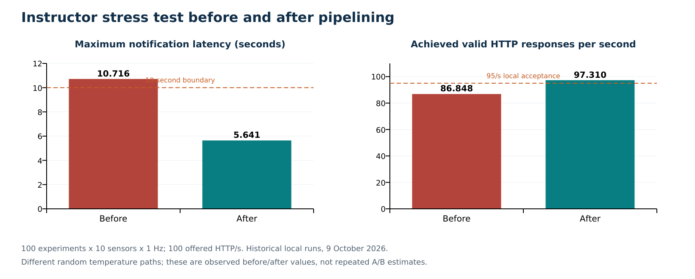
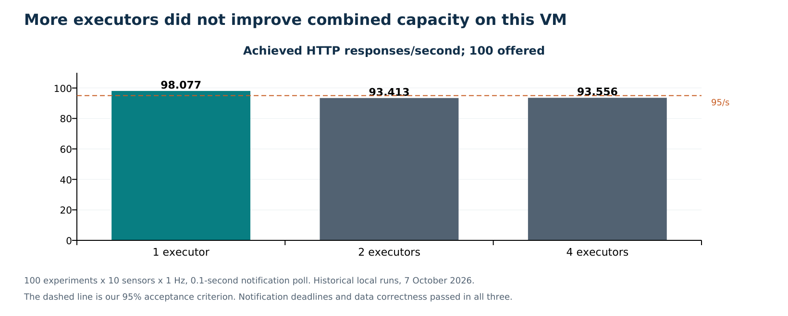

# Performance results and development history

The main measured improvement was replacing individual PostgreSQL state-write round trips with pipelined, version-checked writes. Under the same instructor workload settings, maximum notification latency fell from 10.716 to 5.641 seconds and achieved HTTP throughput rose from 86.848 to 97.310 requests per second. Both runs already returned correct complete histories.

This is a before/after observation from short, stochastic runs. It supports the chosen optimization and motivates repeat testing; it is not an isolated causal estimate or proof of every future workload.

## Test environment and workload definitions

The historical measurements ran on Ubuntu 24.04, two AMD EPYC 7571 vCPUs, approximately 3.756 GiB RAM, and Python 3.12. Kafka, PostgreSQL, Redis, the application, monitoring, and test generators shared the host. Measuring them together captures the actual local footprint while also making the load generator and observability services potential competitors for CPU and disk.

The deterministic harness uses the supplied Avro schemas and independently constructed expected data. The later course harness builds the original Rust producer, notification service, and HTTP validator without editing their logic. It provisions their ground-truth database and adapts the repository's original dashboard to local datasources.

These are separate forms of evidence. The Python notification double validates synthetic test truth; it is not the real cryptographic instructor validator. The October 9 runs use that real validator locally. Neither type measures the complete external network path of a professor-run demo.

## The final instructor workload

| Parameter | Value |
| --- | --- |
| Concurrent main experiments | 100 |
| Sensors per main experiment | 10 |
| Sample period | 1 second |
| Main carry-out samples | 60 per experiment |
| Offered HTTP rate | 100 requests/second |
| Required HTTP observation | At least 60 seconds |
| Warmup | One completed experiment before the main experiments |
| Executors | One, with capacity eight |
| Notification delivery | 0.1-second empty-poll interval, concurrency 32 |
| History comparison | Both complete endpoints, timestamp/temperature tolerance below 0.001 |

The sample input rate during main carry-out is approximately 1,000 sensor events/second, producing 100 aggregate points/second. The 202 complete history comparisons cover 101 experiments including the warmup. These comparisons supplement the continuous instructor HTTP traffic.

## Before and after the database change

| Measure | Initial stress | Final stress |
| --- | ---: | ---: |
| Required notifications | 632 | 610 |
| Received notifications | 632 | 610 |
| Missing notifications | 0 | 0 |
| Notifications above 10 seconds | 3 | 0 |
| Maximum notification latency | 10.715822 s | 5.640533 s |
| Achieved HTTP rate | 86.847621/s | 97.309762/s |
| HTTP validation errors | 0 | 0 |
| Complete history comparisons | 202 correct | 202 correct |
| Local combined result | Fail | Pass |

The recorded maximum fell by **47.36%**, and achieved HTTP throughput rose by **12.05%**, calculated from these two reports. The final maximum had **4.359 seconds of margin** below ten seconds. This margin is not a promise under overload or failures.

The initial commit loop awaited fetchval once for each changed experiment. The replacement sorts experiment IDs, groups adjacent inserts/updates of the same kind, and uses fetchmany. It checks that every proposed state change returned a successful version row; otherwise the whole transaction rolls back.

Sorting before grouping preserves global row-lock order. Checking every return preserves optimistic concurrency. The added test deliberately makes the middle of three versions stale, verifies all three writes roll back, corrects the version, and verifies all three advance. Performance improved while the consistency rule stayed intact. [Exact code](../../temperature_observability/data.py), [regression test](../../tests/test_data_integration.py).

The notification count differs because the original simulator generates random temperature paths. Comparing workload parameters is appropriate; treating 632 and 610 as identical event sequences is not. The record does not include a profiler time breakdown or repeated randomized A/B runs, so the exact size of the optimization's isolated effect remains unmeasured.

## Earlier executor and polling experiments

The October 7 matrix used 100 experiments, 10 sensors, 1 Hz, 30 carry-out samples, and 100 offered HTTP/s. Every row produced all 875 expected notifications and correct histories.

| Executors | Poll seconds | Achieved HTTP/s | HTTP p95 seconds | Notification p99 seconds | Notification maximum seconds | Result |
| ---: | ---: | ---: | ---: | ---: | ---: | --- |
| 1 | 0.1 | 98.077 | 0.689 | 3.587 | 4.025 | Pass |
| 2 | 0.1 | 93.413 | 3.340 | 3.222 | 3.637 | HTTP rate below local criterion |
| 4 | 0.1 | 93.556 | 3.229 | 3.098 | 3.311 | HTTP rate below local criterion |
| 1 | 0.5 | 98.070 | 1.798 | 5.959 | 6.768 | Pass |
| 1 | 1.0 | 97.587 | 1.169 | 3.322 | 3.991 | Pass |

One executor was the smallest passing count. The 0.1-second poll had the lowest observed HTTP p95 among the passing rows, so it became the default. The short runs do not establish that this interval is universally optimal.

Extra executors improved some notification/queue behavior but worsened combined HTTP performance on the shared host. This is evidence against using replica count as a substitute for bottleneck diagnosis. CPU and shared Data/database contention are plausible mechanisms; per-stage profiling would distinguish their individual contributions.

The HTTP p95 values above belong to the deterministic October 7 tests. Do not attach 0.689 seconds to the later October 9 instructor run, whose JSON does not report that same p95 statistic.

## Earlier capacity boundaries

| Sensors | Offered HTTP/s | Achieved HTTP/s | HTTP p95 seconds | Notification maximum seconds | Result |
| ---: | ---: | ---: | ---: | ---: | --- |
| 20 | 0 | Not offered | Not measured | 3.168 | Pass |
| 10 | 200 | 169.703 | 9.387 | 5.186 | HTTP rate below local criterion |
| 20 | 100 | 90.687 | 6.143 | 7.293 | HTTP rate below local criterion |

These profiles used one executor and a 0.1-second notification poll. Histories and notification sets were correct, and notification delays stayed below ten seconds. The combined result failed where completed HTTP throughput did not keep up with the offered rate according to our 95% rule.

The twenty-sensor/100-HTTP profile reached a queue peak of 7,440 events. This warns that notification headroom can disappear before data is lost. The 200-HTTP run completed requests but needed drain time and had high tail latency. “No HTTP errors” is therefore weaker than “keeps up.”

These runs preceded the batch-write change. They should be repeated on the final code before claiming its upper capacity.

## How correctness and recovery were established

The historical full suite passed 52 cases after the batch-write regression: 42 unit and 10 integration. It covers Avro compatibility, sensor averaging, phases, boundaries, duplicates, replay, offset ordering, version rollback, notification leases/retries, query contracts, and metadata-cache races.

The integration suite uses a real PostgreSQL database, the Data application's HTTP handlers, and the deployed gateway where relevant. Redis fallback is deliberately exercised with an unavailable address; a small cache double makes selected cache behaviors deterministic. The separate end-to-end recovery exercise verifies actual Redis loss.

That recovery exercise preserved four history points and three expected notifications through incomplete sensor persistence, executor restart, new-offset logical replay, two injected notification 503s, scheduler restart, Redis outage, and Data/PostgreSQL restart. It proves these specific cases, not arbitrary host-loss availability or every crash window.

On 3 November the unchanged source passed all 42 unit cases again in 1.88 seconds. The ten integration cases were deselected because containers were absent. [Fresh output](evidence/unit-tests-2026-11-03.txt).

## Development decisions and obstacles

| Problem or finding | Change or response | Evidence and lesson |
| --- | --- | --- |
| Sensor readings arrive separately | Persist partial groups and wait for all allocated sensors | A mean must represent a complete sampling instant |
| Producer termination schema differs from header | Decode by record_name and test the quirk | Inspect actual upstream behavior while preserving its validator |
| Replays and worker loss can duplicate work | Atomic checkpoint/state/history/outbox plus identity deduplication | Kafka progress and application effects must agree |
| Concurrent cache fills can retain old metadata | Version keys and writer/epoch fences | Caching is part of correctness, not only speed |
| More executor replicas did not improve combined throughput | Select one measured passing executor; retain a bounded scaling mechanism | Shared-resource limits can dominate parallelism |
| External Kafka failed despite reachable ports | Demo-specific hostname-matching exception; keep CA/client authentication and add a preflight probe | Separate network reachability, server identity, authentication, and assignment |
| Published notification image lacked current public-key configuration | Build the original Rust tools and generate local test credentials | Independent validation was available from source |
| Instructor testing needed an explicit result | Add nonzero-load gates, complete-history checks, result JSON, and one extra dashboard panel | Green/no-data alone is not a meaningful test |
| First full instructor stress missed the deadline | Pipeline state writes and add all-or-nothing version regression | A specific database operation was the optimization target |
| Disk exhaustion later led to killing/removing all containers | Current recovery planning and storage lessons | Process resilience does not replace disk-capacity management |

The first implementation grouped several optimizations into one commit. Apart from the explicit later state-write change and its before/after runs, the record does not establish a separate date or isolated speedup for every earlier optimization.

## Implemented optimizations and their tradeoffs

| Implemented change | Intended saving | Tradeoff or guard |
| --- | --- | --- |
| TaskLookup sends identities rather than full sensor payload | Less internal serialization and transfer | Still requires a consistent database snapshot |
| Batch state writes with fetchmany | Fewer sequential database round trips | Must check all versions and preserve lock order |
| Indexed relational history queries | Less scanning for common queries | Index write/storage overhead |
| PostgreSQL-generated ordered JSON | Less Python response-object work | Database performs serialization |
| Versioned Redis response cache | Fewer repeated history queries | Correct invalidation and bounded memory required |
| Single-process metadata cache | Fewer version lookups | Constrains Data replication |
| Caddy public gateway | Less Python proxy work | Additional configuration must match OpenAPI |
| Pooled aiohttp transport and direct ASGI metrics | Lower per-request overhead | Adapter correctness, including gzip, needs tests |
| Skip unused pool session-reset SQL | Fewer cleanup statements | Only valid while no session state is introduced; rollback is tested |
| Bounded concurrent notifications and immediate backlog draining | Less waiting between batches | Receiver capacity and rate limits still matter |

These mechanisms are in the source. Only the batch-write improvement has the specific instructor before/after pair above; the rest should be explained mechanistically without invented performance percentages.

## Stronger experiments to target Excellent

The following is a proposed test program, not completed evidence.

1. Reproduce the final baseline at least three times after recovery, recording all runs. Use the same configured rates and durations, record source/image identity, and distinguish warmup from observation.
2. Retest the earlier failed fixed profiles to find the final implementation's capacity boundary.
3. Exercise a changing HTTP sequence such as 50 → 100 → 150 → 200 → 100 requests/second while sensor traffic remains fixed. Use documented plateaus, repeat them, and capture backlog recovery.
4. Exercise event concurrency 10 → 50 → 100 experiments at 1 Hz, both evenly staggered and aligned at sample boundaries. Keep the requested main concurrency within 100.
5. Hold the baseline while varying sensors, history duration, cache warmth, and key/partition skew one factor at a time.
6. Run a longer soak and sample filesystem/database growth. Do not multiply a sixty-second latency result into an untested indefinite-duration guarantee.
7. Run fault recovery separately from baseline performance, then characterize which failures preserve correctness and which also preserve the deadline.

The original Rust HTTP tool supports varying batch sizes over generations. Our course runner currently pins min to the requested rate and max to rate+1, so its recorded runs are effectively fixed-rate tests. A controlled changing-rate program and per-phase acceptance calculation require explicit harness/configuration work. Repeating several fixed-rate runs is useful capacity evidence but is not the same as one continuous variable workload.

For each phase, record offered rate, completed valid rate, errors, latency distribution and maximum, required/received notifications, maximum notification latency, queue/lag trend, outbox age, CPU/memory/disk, and recovery time. Compare completed work with the integral of the offered schedule over the same interval. Keep load-generator overhead and request retries visible.

Prefer absolute SLA results and distributions over a single average. p99 under ten seconds can coexist with a late worst-case alert. A green max-delay plot also says nothing about a notification that never arrived, so required/received counts are necessary.

## Evidence index

| Source | What it supports |
| --- | --- |
| [Rubric PDF](../../Group_Assignment_Rubric_INFOMCEC_2026-2027-Final.pdf) | Assessment weights, bands, working-demo gate, individual questioning |
| [October environment](../../benchmarks/2026-10-07/environment.json) | VM, dependencies, cohosted services, source hashes |
| [Sizing matrix](../../benchmarks/2026-10-07/sizing-matrix.json) | Executor/poll comparisons |
| [Twenty sensors without HTTP](../../benchmarks/2026-10-07/sensors-20-http-0.json) | Event-only boundary |
| [Two hundred HTTP requests per second](../../benchmarks/2026-10-07/sensors-10-http-200.json) | Earlier HTTP-capacity failure |
| [Twenty sensors and HTTP](../../benchmarks/2026-10-07/sensors-20-http-100.json) | Earlier combined-load failure |
| [Recovery result](../../benchmarks/2026-10-07/recovery.json) | Specific injected-failure checks |
| [Kafka experiment probe](../../benchmarks/2026-10-08/course-kafka.json) | Historical external assignment |
| [Strict-hostname control](../../benchmarks/2026-10-08/course-kafka-strict-hostname.json) | Historical strict-mode failure |
| [Instructor smoke](../../benchmarks/2026-10-09/course-smoke.json) | Small original-validator pass |
| [Initial instructor stress](../../benchmarks/2026-10-09/course-stress-initial.json) | Pre-fix late notifications/low HTTP rate |
| [Final instructor stress](../../benchmarks/2026-10-09/course-stress.json) | Post-fix passing stated workload |
| [Later check of the same run](../../benchmarks/2026-10-09/course-check.json) | Longer HTTP observation, not another independent experiment |
| [Instructor dashboard check](../../benchmarks/2026-10-09/dashboard.json) | Datasource/query operation and historical panel results |
| [Instructor source/build identity](../../benchmarks/2026-10-09/environment.json) | Unmodified instructor source hashes and build context |
| [Full historical verification](../../benchmarks/2026-10-09/verification.txt) | 52-test result |
| [Current readiness](evidence/readiness-2026-11-03.json) | Stopped deployment, surviving volume names, source comparison, unit result |

The original implementation report and patch remain the full change archive. The strongest oral answers connect one of these observations to the exact mechanism and its limitations.
